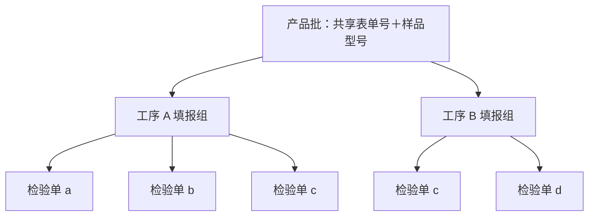

# 无纸化检验系统：新模型与重构计划草案

日期：2026-11-03。版本：v0.3，纳入批次损耗/数量变化填报及原生日期类型要求。状态：重构前设计草案，随后归档；新版工作文档另行建立。本次只整理文档，不修改业务实现或数据库。

## 1. 修订结论与已确认事实

系统定位调整为：**按同一产品批组织、各工序独立填报和汇总、支持记录修订的无纸化检验台账**。保留工序间的产品批归属，取消跨工序子批次之间的来源分配、交接扣量和实物谱系。

原稿将“来源关系可以被可靠记录”作为实现前提，这一前提不符合现场。本版不要求人员补填无法确定的关系，也不以“待关联来源”阻碍正常业务。

已确认：

1. 原始产品批可由贯穿流程不变的**表单号＋样品型号**识别；不能只按样品型号归并。
2. 每道工序自行划分检验批次。上一工序的 a/b/c 可以合并，再由下一工序重新分成 c/d；跨工序的批次号相同也不表示同一批实物。
3. 一张工序检验表单对应一个检验批次；检验批次就是最小检验单位，其内部不会换设备或人员。
4. 一台设备可以承担多个检验批次；设备号不能代替批次号。
5. 子批次进度可以不同步，已完成部分可以先进入下一工序；整批不设“前序全部结束才准填后序”的门槛。
6. 相邻工序的数量允许不同，不做严格总数核对，也不强求解释或补齐每一件产品的去向。
7. 保留每个检验批次的损耗及数量变化原因填报；它是本批次的人工事实说明，不依赖跨工序来源映射。
8. 新系统日期字段改为日期/时间类型：区分只有日期的业务字段与准确时间点，不再以字符串承载正式日期语义。

同一产品批内的跨工序合并、再分批是正常场景，第一版直接支持；系统通过各工序独立建单支持它，不要求新增“合批操作”或可追溯的中间池。不同原始产品批混在一起不是本次已确认的范围，不自动纳入。

## 2. 现状核对与重构判断

建议保留 Go 单体架构、认证、用户、基础字典、样品辅助解析和缺陷字段目录，重构业务身份、工序分组、提交版本及统计。移除来源图后，方案复杂度低于 v0.1，但仍需修改现有核心保存逻辑。

| 方面 | 当前代码 | 新设计要求 |
|---|---|---|
| 表单号 | `forms.form_no` 全局唯一，同号提交定位到同一张记录并更新 | 改为产品批共享标识；同号下允许多个工序、多个检验批次 |
| 样品信息 | `sample_raw` 原文和项目/型号/规格等拆解字段 | 明确用于身份识别的完整业务型号，保留原文；不得擅自用解析片段替代 |
| 工序与批次 | 工序是独立表单上的字符串，没有工序内批次号和机台字段 | 一张检验单明确归属产品批、工序及本工序批次，附本次固定人员和设备 |
| 明细 | `Line` 是计数/缺陷行，提交即删除重建 | 明细仍是单据内容，不提升为检验批次，也不建立二级子批次 |
| 修改 | 字段合并、保存前写历史；没有检查后续工序或锁定前序 | 保留便捷草稿编辑，正式记录追加修订，重算本地统计；无下游来源依赖 |
| 状态 | `ACTIVE/VOID` 与字段完整度 `is_complete` | 区分草稿、正式版本、单批结束、工序填报结束，不能混为一个完成标记 |
| 数量 | 表头可以覆盖明细合计，计数默认零 | 确定正式计数来源，区分未填与零；工序之间允许不同 |
| 统计 | 表头求总数，明细求缺陷，按工序等维度聚合 | 新增产品批/工序/批次身份及版本排重；不要求跨工序物料平衡 |
| 并发 | 保存次数校验可选，响应完成后写幂等缓存 | 正式提交、修订、取消等需版本检查和同事务业务唯一约束，防止重复计数 |
| 权限 | 两级账户，管理员额外管理用户 | 可保留；更正权限需确认，不因本方案强制新增审批制度 |

代码依据：

- [核心模型](../backend/internal/inspection/models.go)、[保存逻辑](../backend/internal/inspection/service.go)、[明细存储](../backend/internal/inspection/store.go)。
- [字段补丁](../backend/internal/inspection/patch.go)、[完成度与校验](../backend/internal/inspection/validate.go)、[现有统计](../backend/internal/stats/service.go)。
- [工序模板](../backend/internal/operations/operations.go)、[样品解析](../backend/internal/sample/parse.go)、[业务路由](../backend/internal/server/server.go)。
- [0003 迁移及表单号唯一索引](../backend/migrations/sqlite/0003_form_submission.sqlite.up.sql)、[幂等存储](../backend/internal/idempotency/store.go)、[幂等中间件](../backend/internal/idempotency/http/http.go)。

当前代码并没有实现“有后序数据后锁定前序”。现有 README、需求和设计文档还混有不同历史模型，后续实施需统一；本稿不将旧文档全部视作已实现能力。

## 3. 新业务模型：产品批、工序、检验单

### 3.1 最小实体

| 实体 | 作用 | 关键内容 |
|---|---|---|
| 产品批 `ProductLot` | 跨工序的共同业务身份 | 内部稳定 ID、共享表单号、身份型号、样品原文/结构化属性 |
| 工序填报组 `OperationGroup` | 同一产品批在某工序的独立填报容器 | 产品批 ID、工序、模板版本、是否结束本工序填报 |
| 批次检验单 `InspectionSubmission` | 一张表单即一个最小检验批次 | 内部稳定 ID、工序组 ID、工序内批次号、固定机台和人员、检验时间、单据状态 |
| 检验单版本 `SubmissionRevision` | 同一张单的编辑/正式修订历史 | 版本 ID、版本号、上一版本、计数/缺陷/纸面信息、修改人/时间/原因 |
| 批次数量变化 `QuantityChange` | 记录本检验批次的损耗及数量变化原因 | 从属于检验单版本，含变化类型、方向、可空数量、原因、发生日期/时间及记录人；不建立跨批来源边 |
| 汇总快照 `ReportSnapshot`（按需） | 固化已查看/导出的报告口径 | 查询条件、时间、实际纳入的单据版本集合和结果；与下游生产依赖无关 |

批次检验单同时承担批次身份和表单身份，不再单独维护两套一一对应的可写对象。版本及计数明细只是单据内容，不是更小的实物批次。不存在批次内换机、换人或再拆批的业务入口。

无分批工序也建立一张检验单，内部使用固定“未分批”标识；界面无需强迫人员填写虚构批次号。已分批的工序以真实批次号区分，各单独立提交和结束。

每个工序组明确采用“未分批单据”或“分批单据”模式；同一统计范围不能同时把整工序合计当作一张原始检验单，再叠加各分批单。若要更正记录方式，应显式替代原记录并保留历史，防止把同一次检验计入两遍。

不建立 `OutputPortion`、`Transfer`、`Allocation`、来源余额、在途预占或批次依赖影响表。批次损耗和数量变化是明确保留的填报能力，随检验单版本保存，不构成必须闭合的跨工序数量流水。

### 3.2 身份与唯一性

建议约束：

- 产品批：`UNIQUE(shared_form_no, sample_identity_key)`。
- 工序填报组：`UNIQUE(product_lot_id, operation_id)`；暂按每产品批每工序一次填报。返工/重复执行同名工序尚未确认，若需要，再增加执行轮次。
- 批次检验单：`UNIQUE(operation_group_id, batch_key)`；未分批以内部保留值表示，不依赖多个 NULL 的数据库行为。
- 正式版本：同一检验单只有一个当前有效正式版本；历史版本不重复计产量。
- 系统内部使用稳定 ID 关联，更改显示文字不通过级联改写标识实现。

**共享表单号不再是单张提交的唯一编号。** 可额外生成只读的单据显示编号，帮助人员区分同一共享表单号下的不同工序/批次；新单、修改旧单必须明确操作，不能继续由“同号就覆盖”决定。

`sample_identity_key` 表示业务确认的完整样品型号。当前解析器中的 `sample_model` 可能只得到 VID1/VID2 等片段，不能直接当作这次确认的“样品型号”。先确认完整型号的书写及规范化规则，保留原文；不做模糊匹配合批，也不随意忽略可能有意义的字符。

同号但型号不同、同型号但表单号不同，都是不同产品批。同型号同表单号在各工序出现时复用同一个产品批。同一产品批下，工序 A 的 c 与工序 B 的 c 是不同的检验单，彼此无实物映射。

身份字段日常录入后保持稳定；拼写纠错使用受控的标识修正及审计，影响整个产品批的查找。若实际录错了所属产品批，应作为明确的单据归属更正处理，展示修改前后归属并重算两边汇总，不根据文字相似度自动合并产品批。

### 3.3 关系示意

图中的连线仅表示数据归属。A/B 的工序顺序用于展示，不在 a/b/c 与 c/d 之间建立连接，不保存“各自来自多少”的分配。各工序人员只需选择共同产品身份、自己的工序和批次，不必知道前序如何分批。

## 4. 核心场景：合并再分批与异步填报

### 4.1 合并再分批

产品批：共享表单号 QS-001，完整样品型号 X。以下数值仅为分类口径已确认情况下的示例。

| 工序 | 本工序批次号 | 设备 | 检验量 | 合格量 | 不合格量 |
|---|---|---|---|---|---|
| A | a | M01 | 400 | 390 | 10 |
| A | b | M01 | 350 | 340 | 10 |
| A | c | M02 | 250 | 240 | 10 |
| B | c | M03 | 600 | 588 | 12 |
| B | d | M04 | 360 | 352 | 8 |

工序 A 汇总 1,000/970/30；工序 B 汇总 960/940/20。现场可以先混合 A 的合格品，再划分 B 的 c/d，系统照常保存以上五张单据。

系统不要求填“B-c 中来自 A-a 多少件”；也不根据比例分摊。970 与 960 的差值可在查看时显示，但不能从差值推断恰好损耗 10 件，更不能生成一条虚构处置记录来凑平。

### 4.2 异步填报

A-a 已结束、A-b/A-c 仍在检验时，B 可以建立并提交自己的检验单。后续 A-b/A-c 完成后，B 可继续新增批次；同一个 B 批次若有后续补填，仍是修订该单，不能重复计数。

产品批总览可同时显示：

- 工序 A：已登记 3 批，已结束 1 批，2 批未结束；展示当前正式汇总和暂报数据。
- 工序 B：已登记自己的批次，存在进行中或已结束的检验单；不必等待 A 整组关闭。
- 两个工序的批次间来源对应未知是正常边界，不是缺失资料待办。

系统能展示的是**已填报进度**。没有单据或状态记录时，不能推断实物尚未开始或停留在哪道工序；不得承诺仅凭表单得到完整实时生产进度。

## 5. 填写、状态与数量规则

### 5.1 各工序独立维护

人员可以查看同一产品批的各工序汇总，但默认工作入口聚焦自己的工序和批次。是否限制编辑他人工序属于权限策略待定项；“人员相互独立”不自动等于必须新增复杂角色体系。

共享身份由产品批提供，机台、批次号、实际检验人员与时间由本单填写，不从前序继承。实际检验人员与系统录入用户继续分开，支持集中代录。

默认工序顺序只用于导航和报告排版，不通过提交时间推断真实顺序，不使用前序数量或关闭状态作为后序提交前置条件。

### 5.2 状态

- 草稿：允许分次保存和缺项，尚未形成正式检验结果。
- 正式记录/单批结束：明确本批结果已登记结束，不等于需要他人审批；同一单后续更正产生正式修订。
- 取消：保留记录及原因，从当前有效结果中排除；历史报告仍可解释原先计入的版本。
- 工序填报开放/结束：人工表明该工序是否还会新增批次。仅仅已登记的批次全部结束，不足以自动认定该工序不会再来新批次。
- 产品批整体结束：需明确应包含哪些工序及谁声明结束，不能从“最后一次提交”自动推断。

字段填齐与单批结束分开。开放状态下的工序也可以显示已结束批次的正式结果，并明确“仍可能继续增加”。关闭仅限制本工序新增单据；更正仍可追加版本，后续补建/补录批次可通过本工序重新开放处理，不牵动其他工序。

同一最小检验批次无需产出分段或设备执行分段。现场提前流转通过不同检验批次先后结束来表达，不要求系统登记实际搬运交接。

### 5.3 数量与统计一致性

| 规则 | 处理 |
|---|---|
| 相邻工序总量不同，甚至后序已登记量大于前序当前合格量 | 允许保存；不计算源余额、不阻断、不认定重复使用实物 |
| 缺少前序记录、后序先录 | 正常按共同产品身份归档；不要求等待来源补关联 |
| 未填数量、明确为零 | 分开保存和显示，不把未填自动计为零 |
| 负数量、失效引用、同一单版本冲突或重复业务提交 | 保证单据自身数据完整性，不通过默认警告绕过 |
| 单批合格＋不合格是否应等于检验量 | 按全检/抽检及栏目定义确认后设置，不把跨工序变化套入单批公式 |
| 缺陷子项合计大于不合格品数 | 保留同片多类缺陷的既有口径，不当作唯一不合格件数 |
| 纸面声明合计与明细合计不符 | 保留声明和差异；正式指标统一事实来源，不让两个报表各取一套真值 |

工序间差值是展示信息，不是准确库存、损耗或可用量。即使两工序都已结束，差值原因仍不能单凭汇总判定。不要求人员补填损耗原因才能进入下一工序。

### 5.4 时间和补录

分别记录实际检验日期/时间和系统录入时间。只有日期的字段使用 `DATE`；准确时间点使用 `TIMESTAMP WITH TIME ZONE`（PostgreSQL 为 `timestamptz`）。应用层采用日期值/时间对象，禁止先格式化为字符串再当作正式数据库时间字段。JSON 中的标准日期字符串仅用于传输。

仅知日期时不补造零点；旧日期原文保留为迁移证据，不能解析的值进入待清洗清单，不填系统当前日期来掩盖缺失。会话、账号、字典、审计及幂等记录的时间字段也纳入改造盘点。数据库和具体日期契约见随后建立的新版设计及日期迁移文档。

相同身份下可以先录后序再录前序；提交时只需正确归档本单，不能再次添加已经存在的检验结果。

产品批表单号与完整型号的匹配采用确定性规则，规范化范围需明确。遇到无法判断身份的录入，可以保留草稿待人工选定产品批；这与要求建立子批次来源完全不同。

## 6. 历史更正：单据修订与汇总重算

### 6.1 推荐规则

取消 v0.1 基于子批次依赖传播的冻结、余额重算和逐个下游核对方案。建议允许对历史工序正式记录追加更正，不因后序已有记录而一律锁死。是否由普通人员或管理员执行仍待确认。

| 更正类型 | 操作 | 重算范围与后序处理 |
|---|---|---|
| 草稿补填 | 修改草稿，保留编辑版本/必要留痕 | 本单暂报数据 |
| 正式计数或缺陷纠错 | 追加版本，保存旧版本、原因和操作人 | 本工序及产品批报告中的该工序数据；其他工序结果保持独立 |
| 机台/人员/业务日期纠错 | 追加版本 | 本单所属设备、人员、日期等分组统计 |
| 误建或重复单据 | 取消重复单，记录理由 | 本工序有效结果去重；不声称已追回或退还实物 |
| 产品批归属或工序归属录错 | 明确归属更正并保留旧新范围 | 原组与目标组及相关汇总；检查目标批次号冲突，不自动合并计数 |
| 共享表单号/身份型号拼写纠错 | 受控的产品批标识修正 | 全批查找与报表标识；不能无审计地改键或自动合并两个产品批 |

此处的重算是**本工序记录的统计修订**，不是对真实产品流向的重演。单据和汇总缓存更新需一致，报表不能同时拼接部分旧版本和部分新版本而不注明。

前序更正不自动修改后序数量、不取消后序单据、不重新执行检验、不强制后序重填，也不冻结整批或某个后序子批。可以在产品批总览记录“工序 A 于某时修订”，便于查阅；这是数据变更提示，不表示已证明后序某单受影响。

### 6.2 示例

将前例 A-a 从 400/390/10 更正为 400/380/20：

1. A-a 保留 v1，追加 v2；当前正式版本为 v2。
2. A 汇总改为 1,000/960/40，设备 M01 与对应人员统计同步改变。
3. B-c 与 B-d 均保持原记录，B 汇总仍为 960/940/20。
4. 不计算“哪个 B 子批应扣掉 10 件”，不生成产出不足待办，也不因为更正触发补填来源。
5. 查看旧报告仍能解释 A 曾按 v1 汇总为 1,000/970/30。

若上游更正反映真实质量事件，业务人员可能需要另行核实后续产品，但本系统不能自动定位具体下游子批。该能力缺口不能用“把所有后序批次都标成受影响”来伪装成精确追溯。

### 6.3 版本与报告

单张检验单采用线性修订；同一时间只有一个当前有效正式版本。新草稿尚未正式发布时，原正式版本继续用于正式统计；不能因为创建修订草稿就把原结果从报表中移除。

保留每次修改的内容、原因、操作人、录入时间、业务时间，明确正式生效时点。当前报告取当前正式版本；历史报告按当时已生效版本或固化快照查询。快照记录实际纳入的版本集合，不表示后序人员当时阅读或依赖了这些版本。

不引入整批树状分支和自动合并。若未来存在真实重新检验，则是新一轮业务记录，需要单独定义去重口径，不能通过编辑历史伪装新增产量。

## 7. 汇总与明确舍弃的能力

### 7.1 保留并实现的汇总

| 指标 | 口径 |
|---|---|
| 产品批索引 | 共享表单号＋完整样品型号，同批各工序统一展示 |
| 工序正式结果 | 当前有效、已结束检验单的正式计数求和；草稿/取消/旧版本分开 |
| 工序批次清单 | 本工序批次、固定设备/人员、状态与单据版本；工序内可独立查询 |
| 工序合格率 | 有可比且完整分母时取合格量合计÷检验量合计，不平均各单百分比；未知与零分别处理 |
| 设备、实际人员和系统录入工作量 | 各自按检验单或操作记录统计，不把检验人员和代录人员混用 |
| 缺陷分布 | 保留类别×表面计数，不推导唯一不良件数 |
| 批次损耗与数量变化说明 | 按本批次当前正式版本查询；只汇总明确声明且有数量的同类变化，未知数量另列，不从工序间差额反推 |
| 填报进度 | 各工序已登记/已结束/未结束单数、是否结束本工序填报；未计划批次数量未知 |
| 终点工序结果 | 明确终点且其填报已结束时，展示该工序合格数；不称作准确出库量或实物流转余额 |
| 跨工序累计检验量 | 只能标为检验工作量，同一件经过多工序会重复计入 |

“最新版合并表单”可以保留为只读报告：按工序分区，分区内列批次和小计。设备、人员、时间等多值并列显示；不能把各工序全部数量压成一行“总产品数”，也不能只取最后一位人员覆盖前序人员。

### 7.2 因现实约束正式舍弃

以下能力从本次重构范围中删除，正常使用不要求补齐这类数据：

- 跨工序子批次父子映射、来源图及合并/拆分数量分摊。
- 确切交接去向、发出/接收闭合、产出预占、可用余额和准确在途库存。
- 自动验证同一份实物是否重复进入后序，或自动证明“只有前序合格品流到后序”。这是现场规则，系统缺少对应证据。
- 上游更正后精确圈定受影响的后序子批、自动追溯召回。
- 根据相邻工序差额自动确定损耗、封存、抽检或丢失数量。
- 单片级去重、跨工序缺陷归因、精准全流程物料平衡和由此计算的全流程良率。

已具备的是同一产品批的多工序记录关联与统计，不承诺子批次实物追溯。真实生产若需要召回，仍需现场标签或其他可追踪信息，不能从本系统现有信息自动还原。

### 7.3 收紧的旧行为与保留项

需要收紧：同号自动覆盖整张提交；正式版本原地任意修改；旧版本与新版本一起计产量；把字段完整度当作实际完成；人工表头和明细同时作为相互矛盾的正式真值。

明确保留：统一纸单外观、原始样品信息、所有已知缺陷栏目、机台与批次、固定人员、批次损耗和数量变化原因、分次填写、集中补录、两级账户及管理员密码、基础字典/参考清单、无强制审批、工序间数量不同及后序独立填报。

## 8. 重构影响面与原稿范围削减

| 模块 | 本版调整 |
|---|---|
| 核心模型与数据库 | 产品批→工序组→批次检验单→版本；移除产出、来源分配、交接、余额与依赖表 |
| 保存与版本 | 明确新建/修改对象，正式修订需版本校验；取消跨工序依赖传播和冻结 |
| 表单号与 API | 共享身份与单张提交 ID 分离，新增明确的分组接口；旧按同号更新语义不直接兼容 |
| 统计 | 新增共享身份、工序/批次、设备维度及正式版本排重；删除物料平衡、来源与在途报表 |
| 字段与模板 | 增加机台号和批次号，版本化模板；一单一批，不增加批次内执行分段 |
| 样品解析 | 明确完整身份型号与解析片段的差别；设备/批次候选可辅助，不用于自动建谱系 |
| 认证/用户/字典 | 基本沿用，确认更正权限；设备主数据可选，不强制建立新审批 |
| 并发/幂等/审计 | 防重复提交、重复版本和并发覆盖；不再需要来源余额锁、交接扣量事务 |
| 前端/调用方 | 产品批入口、工序页、批次单与只读汇总；无需来源选择、交接确认、实物关系图 |
| 迁移/测试/文档 | 修正表单号语义和分组方式，旧历史保持可查；按新范围重写业务验收 |
| 日期与数量变化 | 新增版本化数量变化明细、原生日期/时间类型及旧日期清洗；覆盖数据库、应用、API、报表、审计和会话 |

建议继续在现有 Go 单体中实现，沿用数据库能力。可采用新业务表与 `/api/v2` 契约，保留旧域只读查询；不需要微服务、工作流引擎、全量事件溯源或通用分支管理。核心重构仍较大，重点从流转账转回身份分组、记录修订及统计，减少跨工序耦合。

批次损耗及数量变化说明纳入第一版，随检验单一起填写、修订和汇总。记录可只说明原因、数量未知；损耗不等于不合格品，也不自动从合格数再次扣减。抽检、封存、返还等需明确是否真的改变数量，不一概算成损耗。交接、来源分配和库存闭合仍不纳入。

## 9. 风险与处理

| 风险 | 影响 | 处理 |
|---|---|---|
| 旧表单号唯一约束和自动更新行为未改全 | 后序或新批次覆盖前序 | 必须同时修改数据库唯一键、查找路径、API 和重试行为；用同号五单案例验收 |
| 完整样品型号被误用为 VID 等解析片段 | 产品批误合并 | 独立定义身份型号字段与确定性规范化，保留原文，不做模糊合批 |
| 跨工序同名批次被当作同一批 | 统计串单、错误追溯 | 批次身份限定于产品批工序组，禁止跨工序批号自动关联 |
| 现场认为系统有精确追溯能力 | 更正或质量事件中误判范围 | 界面和报告明确只按产品批汇总，不展示猜测的来源/影响范围 |
| 实际进度领先于录入 | 误以为产品未开始或仍在前序 | 标明填报状态、实际/录入时间，不承诺完整实时生产进度 |
| 正式结果更正、取消与统计不同步 | 报告前后不一致或重复计数 | 单据版本指针、审计及汇总更新一致；报表使用同一查询口径/版本集合 |
| 工序开放期间把已登记批次当全部批次 | 过早宣称工序/整批结束 | 显式开放/结束标记，允许受控重新开放；不由字段完整度自动关闭 |
| 历史数据身份字段不全或含义不同 | 错误归组、记录覆盖 | 原文保留，按确认映射迁移；不明归属留历史记录，人工处理产品批归属 |
| 跨原始产品批混料或返工后来出现 | 超出当前身份与执行次数约定 | 明确尚未覆盖，不猜测；确认后单独设计实例和统计归属 |
| 新旧业务同时写入或直接恢复旧备份 | 重复结果或丢失新记录 | 明确产品批/切换时间的写入边界，备份演练与切换后数据保全 |

## 10. 更新后的实施计划

| 阶段 | 产物 | 验收/退出条件 |
|---|---|---|
| P0 术语与纸单校准 | 确认完整型号写法、工序内批号唯一范围、未分批表示、计数口径、结束与更正权限 | 已确认的一单一批、固定人员设备及无跨工序来源要求固化，不再重复调研 |
| P1 数据与 API 定稿 | 共享表单号身份、工序组、批次单、线性版本、统计契约及旧数据映射 | 同号同型号 A-a/b/c 与 B-c/d 共存；编号无覆盖；不出现来源依赖 |
| P2 独立填报闭环 | 产品批入口、工序建单、机台人员、草稿/正式、结批与工序开放状态 | 前序未结束时后序可填；混合再分批无额外操作；固定一批一单 |
| P3 更正与汇总 | 版本更正/取消、按工序和设备汇总、历史口径或报告快照、调用方适配 | 更正 A 只改变 A 的结果和相应分组，B 保持独立；无冻结/自动重填 |
| P4 迁移与试点 | 盘点本地及其他环境记录、保留账户/字典、按确定身份归组、真实样例试录 | 实际人员可以独立填自己的工序，不需要知道上道批次来源；历史可查 |
| P5 切换 | 旧域只读、新域写入、文档和脚本更新、恢复演练 | 无混合写入，正式/历史结果可解释，舍弃能力在交付中明确 |

各阶段同时纳入数量变化字段/API、原生日期数据库选择、全库时间盘点与迁移、非法日期隔离、时区边界及版本化损耗统计的验收。SQLite 无原生日期存储类型，不能靠修改列名或声明为 DATE 就声称满足要求；PostgreSQL 原生日期类型为建议落地方案，数据库选择尚未确认，也尚未实施切换。

删除原计划中的来源图建模、产出和交接闭环、余额/在途管理、后序依赖核对及相关并发测试。合并再分批属于 P2 正常场景，不再排到未来扩展。

账户和密码哈希原样保留，不依赖清库或重新引导管理员。此前清理本地测试数据不等于其他环境没有真实数据，也不授权本次清库。工期在 P0/P1 确认剩余边界后估算，不沿用 v0.1 的范围假设。

## 11. 更新后的验收场景

1. 同表单号＋同完整型号的所有工序正确归为一产品批；只同号或只同型号不误归组。
2. A-a/b/c 与 B-c/d 同时存在、设备可复用；两个工序的 c 互不覆盖或自动关联。
3. A 的多个批次混合后由 B 自行分批可直接录入，不出现来源分摊、交接确认或待关联来源要求。
4. A 仍有未结束批次时 B 可提交；后序先录、前序后补均正常，跨工序数量差异不阻断。
5. 无分批工序只需一张单；每张单固定一组人员和设备，不出现二级批次或换机分段。
   同一工序的原始单据与只读汇总分开，不同时叠加未分批总单与分批明细单。
6. 草稿、正式、取消、旧版本和零/未知计数分开；正式修订草稿不会提前替换旧正式结果。
7. A-a 从 400/390/10 更正为 400/380/20，A 汇总和设备/人员统计改变，B 保持 960/940/20；不冻结、不扣减、不重填后序。
8. 新建、修订、取消在重试和并发时不重复计数、不覆盖他人版本；批次号冲突返回明确提示。
9. 报表按工序分区和小计，合格率加权正确，原单与汇总不重复相加；历史报告可找到实际版本集合。
10. 工序开放时明确结果可能继续增加，单据齐全不自动宣称整体结束；未登记不被解释为未生产。
11. 相邻工序差值不被命名为准确损耗或库存；终点工序合格数不冒充准确出库量/全流程良率。
12. 迁移保留管理员、字典和旧记录，不依赖单号自动覆盖，不补造实物流转关系。
13. 批次可填损耗数量与原因，也可只填原因、数量未知；历史更正不重复计入损耗，不自动改变本批或后序的检验结果。
14. DATE 与准确时间点分别存储；非法日期拒绝、未知为 NULL、只知日期不补时刻，日期查询不再字符串切片或比较。
15. 旧数据按可解析/歧义/非法/缺失分类迁移，跨午夜按业务时区归日，会话过期与账号锁定不因时间类型变化失效。

以上是后续实施验收要求，本次仅更新设计，未实现或执行这些测试。

## 12. 已关闭的问题与剩余待确认项

已关闭：产品批由表单号＋样品型号识别；一单一检验批次；批次为最小检验单位；人员设备在批内固定；同一产品批跨工序可合并再分批；不要求跨工序子批次映射。不能在后续计划中重新以“暂未明确”恢复来源分配或执行分段。

本次另已确认：批次损耗及数量变化原因保留；正式日期字段使用日期/时间类型；旧文档归档后建立新版需求、设计、API、迁移及重构进度记录。具体数量变化枚举、日期精度映射和数据库落地策略作为新版设计建议进一步定稿。

| 待确认项 | 影响 |
|---|---|
| 作为身份的完整样品型号具体写法、空格/大小写等规范化；同工序批号会否重复 | 身份字段和唯一范围；若重复则增加真实区分项，不能靠新版本合并两次真实检验 |
| 哪些工序全检/抽检，单批检验数与合格/不合格数如何定义 | 单批校验及工序合格率分母，不影响跨工序独立 |
| 谁声明本工序不再新增批次，终点工序与整批结束如何确定 | 结束状态和最终工序报告 |
| 允许哪些人员更正历史正式记录，是否接受本版“后序存在仍可追加修订”的建议 | 更正权限和入口；不需要因此建立实物来源 |
| 是否存在真实重复检验/返工、同名工序多次执行，或跨原始产品批混料 | 当前单次工序组之外的扩展，未确认前不自动支持 |
| 现场录入与集中补录的主要方式、需适配的界面/API、各环境迁移范围 | 调用方工作量、历史映射、切换计划 |

本版以“不保存无法采集的实物关系”为设计边界。剩余确认围绕纸单身份、单批计数、填报状态及版本策略，不再把交接账或子批次追溯当作系统成立的前提。
