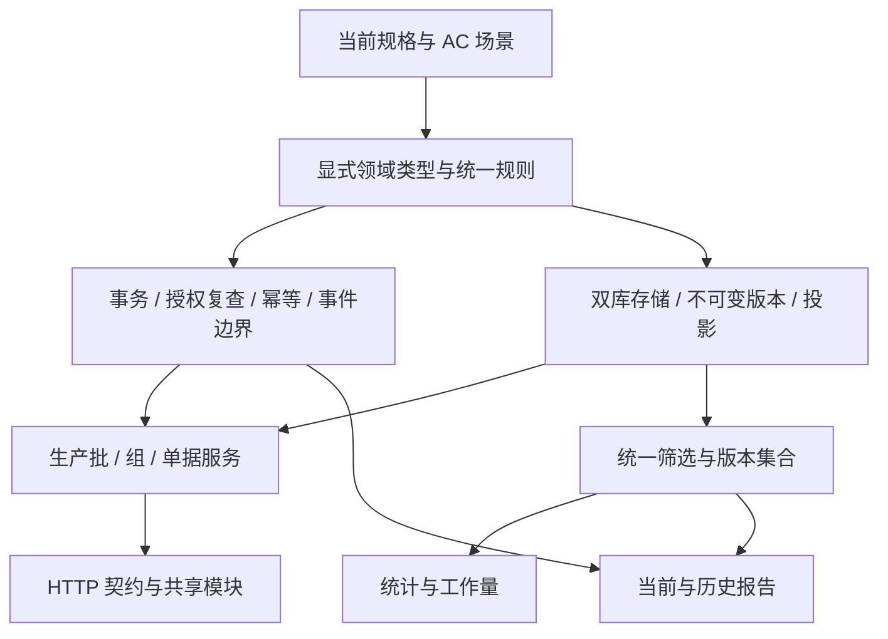

# 二次重建评估与实施计划

评估日期：2026-11-05。原评估代码基线：`13d1c05`。本文保留评估时的差异证据与两轮施工安排；其中“现有代码”“下一步”指该基线时点，不能作为当前完成状态。第一轮结果见 [G1 验收记录](rebuild-g1.md)，第二轮结果见 [G2 验收记录](rebuild-g2.md)。

业务与接口依据为[需求](requirements.md)、[功能说明](features.md)、[字段目录](fields.md)、[系统设计](design.md)、[公共设计](common-design.md)、[API](api.md)及[参考资料](reference-data.md)。本文安排工程工作，不新增业务规则；遇到规格缺口须先确认，再同步规格和实施项。

## 1. 评估结论与实施边界

建议分两轮实施：第一轮清理旧语义并重构底层，交付经过验证的模型、存储与共享基础；第二轮在此基础上逐项接回业务服务和接口，完成查询、统计、历史报告与交付验证。两轮之间设明确验收门槛，第一轮中间态只在隔离开发环境运行。

现有代码已具有生产批、独立工序组、检验批号占用和检验单版本结构，未发现需要保留的跨工序来源分配实现。主要偏离来自第一次重建采用的草稿/发布模型，以及共享模块继续沿用的旧单位、解析缓存、字段目录和审计约定。仅把保存接口改名或在保存后自动调用发布，会继续留下两套状态、历史与统计来源，不能完成本次重建。

保留 Go/Gin/sqlx 模块化单体和双数据库方向。基础设施、密码算法、独立工序身份、占用规则与部分统计算法有复用价值；台账写入编排、查询选择、历史回放和对外对象需要按目标规格重写。复用以验收规则成立为条件，不以文件或测试原样保留为目标。

用户已确认：**保留账号及配置；现有检验业务数据均为测试数据，可以重置。** 因此本计划不安排旧草稿、已发布单据和检验历史向新语义迁移。重置在后续实施时针对明确目标库执行，本次评估不操作现存数据库。

本次及两轮核心实施范围为后端和对接契约。仓库没有前端应用；不另建前端工程。Excel/CSV、打印/PDF、历史台账导入继续排在核心闭环之后，不能作为重建完成的前置依赖。

## 2. 评估方法、实测与证据限制

已阅读运行入口、路由、中间件、台账服务/内容/查询/报告、账号会话、字典、解析与缓存、SQLite/PostgreSQL 迁移、种子与重置工具、本地/容器启动脚本、CI 及现有测试，并逐项对照当前规格。未读取现存业务记录、账号密码或实际环境连接串，未启动服务或容器。

| 检查 | 本次结果 | 能说明的范围 |
|---|---|---|
| `go version` | 本机 `go1.27.1 windows/amd64`；go.mod 声明 `1.26.0` | 本次编译环境，不代表容器验证 |
| `go test ./... -count=1` | 通过 | 当前实现与现有断言相容；不能证明符合当前 v2 |
| `go vet ./...` | 通过 | 当前静态检查通过 |
| `go build ./...` | 通过 | 本机全部 Go 包可编译 |
| PostgreSQL 本地集成 | 未运行，未配置 `LENS_TEST_POSTGRES_DSN` | 双库一致性仍须在实施时实测 |
| CI 配置审阅 | 已配置 SQLite/race、vet、build，以及 PostgreSQL 台账测试 | 仅确认配置存在，未查询远端执行结果 |
| 性能、恢复、部署 | 未实测 | 无现存性能或可恢复性结论 |

现有测试中 `TestSamplingLoss` 明确接受抽检 LOSS，通用内容夹具使用部门文字“一厂”作为纸面单位，生命周期与历史测试依赖 publish。测试全绿反而可能把偏离固定下来。下一步必须同时处理测试语义，不能把“保持原测试通过”作为业务正确性的标准。

证据来源可直接从下表定位到文件和符号；这里的“缺失”指在所审阅实现中未见目标能力，不指运行环境一定没有外围措施。

## 3. 代码与规格差异清单

“基础”项必须在第一轮处理或建立经过验证的底层支撑；“搭建”项在第二轮完成。关联工作包见第 6、7 节。表中已删除的旧源码路径保留为代码文字，可在原基线 `13d1c05` 中查阅；其余源码链接仅供定位路径，差异行为以原基线为准，不能把同名重写的现行实现当成旧证据。

| 编号 | 代码证据与现状 | 目标与处置 | 所属工作包 |
|---|---|---|---|
| E-01 | `internal/ledger/service.go` 的 createSubmission/saveDraft/submissionAction 和 [0005](../backend/migrations/sqlite/0005_v2.sqlite.up.sql)：DRAFT/PUBLISHED、双指针、发布时原地更新版本 | 基础：改为 ACTIVE/CANCELLED、唯一当前指针、不可变保存版本；彻底退出发布分支 | A-02、A-03、A-05、B-01 |
| E-02 | [http.go](../backend/internal/ledger/http.go) 注册 PATCH `/draft` 与 POST `/publish`；响应含 current/draft 两套内容，直接输出数据库 map | 基础/搭建：明确请求/响应类型；按契约 PATCH 单据、返回 revision/derived/issues；旧路径不留兼容别名 | A-02、A-05、B-01 |
| E-03 | `internal/ledger/content.go` 保留 declared_counts、paper_submitted_raw/paper_inspected_raw；derived 输出 declared_differences 与标量 line_totals | 基础：删除独立声明及日期原文入口；保留表头唯一统计来源；核对结果改为契约结构，禁止派生字段进入内容 | A-02、A-03 |
| E-04 | content 的单位只有字符串类型检查；[字典路由](../backend/internal/dictionary/http/http.go) 可 POST `/units`；[用户](../backend/internal/users/store.go) 使用 unit_id | 基础：固定 PIECE/片只读目录；单位合并后严格验证；department 与计量目录分离 | A-02、A-03、A-04 |
| E-05 | mergeContent 不按类型拒绝 LOSS；[query.go](../backend/internal/ledger/query.go) 的 changeStats 仅在汇总时排除抽检 LOSS | 基础：单笔、补丁、批量在写服务统一硬拒绝；移除“允许存但不计”的新写入路径 | A-02、B-01 |
| E-06 | groupAction 关闭组前检查 DRAFT 并返回 unfinished_submissions | 搭建：关闭只限制新增/绑定，不检查完整度，也不禁止已有单更正和取消 | A-05、B-01 |
| E-07 | audit 只有 actor_id 与秒时间，没有事务标识、当时姓名；[reports.go](../backend/internal/ledger/reports.go) 接受范围内任意日志 ID 作为上界 | 基础：事务末事件边界、操作者快照、持久化逻辑事件时间；搭建：报告只接受完整已提交领域事务上界 | A-03、A-05、B-04 |
| E-08 | revisions 缺 content_schema_version/saved_actor_name；组缺工序标签与创建证据；生产批缺 created_by；[fieldCatalog](../backend/internal/ledger/http.go) 硬编码 v2.1，无不可变 schema/template 存储 | 基础：补全证据及字段/模板版本，防止改名、模板变更污染旧版 | A-02、A-03、A-04 |
| E-09 | facts 全表读取单据，循环读取组/批/版本；page 在内存分页；筛选缺纸面多人员、样品、原文、最近保存者等；存在 has_draft | 搭建：统一筛选与投影查询，数据库分页、批量取详情；移除草稿筛选，补齐当前版条件 | A-03、B-02 |
| E-10 | aggregate 虽已使用表头 counts 且保留未知，但只检查合计分子；无单据不返回 no_records；数量变化缺完整数值结构；统计无事件上界/分组分页 | 基础：复用未知量思想，重做统一可比性规则；搭建：补齐响应与分页，不让合计掩盖单张异常 | A-02、B-03 |
| E-11 | ledger 路由没有 `/stats/dimensions`、`/stats/workload`；auditList 仅实体条件；报告进度仍统计草稿/发布 | 搭建：完整实现维度、两类工作量、审计筛选、有效/取消/缺项进度，复用同一版本集合 | B-03、B-04 |
| E-12 | [dictionary/store.go](../backend/internal/dictionary/store.go) 同时支持 process/inspection_operation；meta 为字符串；图号查询默认最多 500，匹配 LIMIT 1；UpsertDrawings 逐笔非事务；导入接受 rows 并跳坏行 | 基础/搭建：规范目录数据及类型，工序只用 inspection_operation；原子结构化导入、分页、多候选，不静默截断/跳过 | A-03、A-04、B-05 |
| E-13 | `internal/sample/http/http.go` 的 GET cache 调用 Parse 写缓存；[sample/service.go](../backend/internal/sample/service.go) trim 原文并可能回显缓存旧原文；缺解析器/目录版本与确认防覆盖协议；is_rx 是非空 bool | 基础：定义可空结果与缓存元数据；搭建：只读 cache、当前原文回显、候选与确认完整映射、版本失效和并发防覆盖 | A-02、A-03、B-05 |
| E-14 | [auth](../backend/internal/auth/service.go) 登录停用/锁定返回 403 且区分原因，改密最低 6 位；[middleware](../backend/internal/middleware/middleware.go) 静默优先 Cookie，允许 X-Auth-Token，缺 Cookie 写来源校验；[users](../backend/internal/users/store.go) PATCH 指针不区分 null 清除 | 基础：按现有契约统一认证、授权、错误与三态更新；保留旧哈希登录能力；补最后管理员与事务审计等约束 | A-02、A-04、A-05 |
| E-15 | [0006](../backend/migrations/sqlite/0006_v2_release.sqlite.up.sql) 删除旧表及部分日志并建立旧回放基线；[migrate.go](../backend/internal/store/migrate.go) 以版本号跳过，无内容核验/迁移互斥；status 会建迁移表 | 基础：旧迁移不改写，新增受控重建迁移和只读预检；重建后不沿用旧历史起点；实际库版本先盘点 | A-01、A-03、A-06 |
| E-16 | [容器入口](../backend/docker-entrypoint.sh) 每次迁移/默认种子；[dev.ps1](../backend/scripts/dev.ps1) 带迁移、种子、可选重置，输出管理员密码/DSN；Compose/脚本存在固定引导凭据；[server](../backend/internal/server/server.go) healthz 恒成功 | 基础：拆开启动/初始化/重置入口、保护配置和密码；搭建：依赖检查、部署及备份演练 | A-06、B-06 |
| E-17 | `internal/ledger/acceptance_test.go`、`internal/ledger/release_test.go`、`internal/ledger/invariants_test.go` 混合有效防重/回滚断言和旧发布/单位/抽检断言 | 基础/搭建：逐条分类迁移，保留有价值的并发/回滚案例，替换错误期望；以 AC-01～26 建立覆盖清单 | A-01、A-07、全部 B 包 |

另两项需要在重构时一并验证：integer 的 json.Number 分支仅检查 int64，没有统一契约安全整数上界；数量累计也需防溢出。多数数据库异常目前统一变成 503，应区分预期冲突、暂不可用和内部错误，避免以重试掩盖实现缺陷。

## 4. 保留、改造与退出清单

| 范围 | 处理方式 | 复用条件 |
|---|---|---|
| Go 模块、Gin 路由装配、sqlx、驱动、Docker 构建框架 | 保留 | 不为本次重建更换框架、ORM 或拆微服务；构建版本在交付时统一验证 |
| config、database、id、password、httpx、中间件 | 保留后修正 | 校验配置范围、上下文/超时、规范错误、来源检查；不输出秘密；Argon2id 旧哈希仍能验证 |
| users/auth | 重构边界和协议 | 保留账号 ID/密码/类型/启停及配置；取消对旧台账锁表名的直接耦合；权限更改、撤销与审计同事务 |
| dictionary/sample | 保留数据价值及可验证的解析算法，改造存储/服务/协议 | 不丢人工配置；单位只读、原文不改、多候选、缓存只读与确认优先规则成立 |
| formfields、35 类缺陷顺序、参考 CSV | 核对后保留并扩充 | 与字段/参考文档一致；补 schema/layout，删除旧字段；初始化不覆盖人工维护 |
| ledger 的批身份、分组、占用、未知量算法 | 按规则拆取复用 | 不携带草稿/发布分支、旧字段或 SQL map 作为领域对象 |
| ledger 的写流程、详情组装、筛选、报告 | 按目标模型重写 | 使用同一事务与选定版本集合；不另建第二套业务事实来源 |
| 0001～0006 已有迁移 | 保留文件和已应用记录 | 作为历史升级链，不作为新领域设计；新增迁移/重建工具，不覆盖文件或伪造已应用版本 |
| DRAFT/PUBLISHED、draft/publish 端点、双内容指针、声明/日期原文、新增单位入口、process 同义类别 | 从运行路径退出 | 仅允许出现在历史迁移、迁移输入识别和拒绝旧协议的测试中 |
| reset/seed/dev/entrypoint 与旧测试 | 分别改造 | 每个入口职责明确；测试清理不改账号密码；不把旧断言机械改到“能绿” |

不在源码旁复制整套 legacy 业务包并继续注册旧路由。旧实现可由 Git 基线查阅；迁移确需识别旧表时，把范围限制在迁移代码。第一轮删除旧行为之后，应能通过搜索与路由测试证明它已退出运行路径。

## 5. 两轮之间要稳定的边界

### 5.1 依赖方向

保持现有模块目录，按职责在模块内拆文件；以下名称表示职责，不强制为了目录形式搬家。

规则先从规格与场景确定，再决定类型、约束与查询；不能从旧表方便程度反推业务。HTTP DTO、领域内容、存储行和历史快照分别定义，禁止通用 `map[string]any` 在这些层之间透传。字典 meta 等开放 JSON 可以保留 map，但必须在边界检查类型与允许值。

### 5.2 必须先固定的六项

1. **内容与补丁。** 明确未传/null/值，数组替换，样品原文不改；counts 是唯一三计数来源。统一服务验证单位、日期、整数、缺陷、类型和 LOSS；单笔/批量不另写规则。
2. **当前与历史。** ACTIVE/CANCELLED、一个 current_revision_id；保存版本不可变。内容、投影、最后保存者、占用与审计同事务，取消不伪造内容保存动作。
3. **引用与占用。** 同生产批跨类型共 ID；组按工序/类型；整批分批互斥、具名唯一；当前指针/上一版本属于本单，组与单类型相符。
4. **写事务。** 数据库写闸门、事务内当前账户复查、expected_version 条件更新、幂等结果同提交；事务内所有事件共享 transaction_id；失败不留下版本、占用或成功缓存。
5. **可复验快照。** 写闸门维护不回退的逻辑事件时间与完整事务末事件；一致读先固定单据/当前版本集合，分页与统计共用。共享认证日志不能伪装成领域报告边界。
6. **字段解释。** schema/template 版本与显示名/工序标签快照可持久读取；历史不会套用今天的字段目录。固定单位与用户部门各有独立模型。

### 5.3 第一轮中间态

第一轮保留并修正认证/用户、共享目录等必要入口，业务台账路由暂不挂载；旧 draft/publish 路径返回 404。新库结构与领域规则通过内部集成用例验证，不借保留旧业务接口来维持表面可用。解析接口若尚未按 B-05 接好，也不挂载旧缓存行为。

这一中间态不对外发布，不给前端作为完整 v2 联调环境。第二轮业务接口完成一个工作包才挂载一组；任何已挂载接口都遵守当前契约，不以临时双协议过渡。

## 6. 第一轮：清理与底层重构

执行主序为 A-01 → A-02 → A-03 → A-05 → A-04 → A-06 → A-07。A-02/03/05 围绕下列贯穿样例小步迭代，不先批量搭完所有抽象层。共享事务能力优先于依赖它的账户维护和目录审计，避免各模块再次自建协议。

第一轮先固定三组贯穿样例，在内部服务/仓储集成层执行，结果直接核对规格期望：

- 同一生产批建正常/抽检两组，后序先录，保存表头 100/96/4、明细 90/85/5；选定当前版本仍取 100/96/4，改明细不改表头，抽检 LOSS 全事务失败。
- 未归组单分次保存后绑定，绑定前没有统计资格/占用，绑定后立即具备；关闭组仍可更正已有单，取消释放批号，另一竞争请求只能有一个成功。
- 一次保存产生多个事件，失败无半写；原键重试不新增版本；后续更正不影响原版本集合，任意事务中间事件不能被接受为快照上界。

这些样例只验证最小业务事实、存储和事务，不提前搭完第二轮列表/统计/报告 HTTP。若样例暴露模型问题，先修正规则与基础，再扩展共享模块；不把偏离留给上层补偿。

### A-01 固定验收与保全清单

- 建立 AC-01～26 到规则/接口测试的映射，列明未实现项；固定典型业务数据，不沿用“一厂”、抽检 LOSS、发布才能入统计的夹具。
- 分类现有测试：保留并调整调用方式、替换错误期望、移入仅验证旧结构输入的迁移测试、删除已失效用例。保留并发占用、批量回滚、幂等失败回滚、未知量和独立工序案例。
- 为后续实施编写只读盘点：目标库驱动/位置、迁移版本/名称、表结构、账号与配置数量、引用和冲突。不输出密码哈希或 DSN 凭据。
- 先在库副本验证备份/恢复与保留字段，再编写破坏性重建步骤。实际库结构未盘点前不假定已到 0006。

完成条件：验收矩阵与保全字段明确，旧测试没有被误当需求；清理对象范围可核对。不能以删掉失败测试代替目标验收。

### A-02 领域类型、字段目录与纯规则

- 定义批身份、组/单状态、检验类型、Nullable 数量、日期/时点、完整内容、三态补丁及只读派生类型。
- 集中实现单位/日期/整数安全边界/seq/枚举/LOSS 校验；五项完整度只提示；表头与明细差异、数量算式、缺陷重叠等 warning 使用 API code/path。
- 实现统一计数单元、单内缺陷完整性、良率理由优先级；单张分子超过分母不能被汇总掩盖；声明变化与表头不相互扣补。
- 字段目录扩展到所有纸面栏目、样品五项、105 格缺陷、身份与派生路径；保存 schema/template 版本定义。解析结果和共享资料 DTO 使用正确 null 类型。

完成条件：独立于 HTTP/SQL 的规则用例覆盖 AC-05、10、11、14、16、19、22、23、25、26 对应边界；字段与文档一致。新规则不接受旧声明/日期原文，不从明细回填 counts。

### A-03 双库结构与存储边界

- 根据系统/公共设计新增迁移；建议从 `0007` 起，最终编号以实施时迁移目录为准。移除旧业务表的测试内容并重建目标结构，保留并转换账号和配置。
- 构建显式存储类型与仓储方法，分别处理方言；补齐证据快照、内容 schema、最后保存、筛选投影、事务元数据、幂等与历史起点。
- 新旧 users/unit 数据先转存再改结构；字典/图号/人工缓存按第 8 节保留策略处理。迁移失败不能留下半套公共数据。
- 验证 current_revision_id 非空与“版本必须属于本单”的循环引用插入顺序。可用预分配 ID 和延迟到事务提交检查的外键；两库都必须真正验证，不能永久放松约束或提交空指针。
- SQLite 表重建、PostgreSQL 约束顺序、单据/版本相互引用、占用释放、NULL 唯一性、查询索引分别验收。无业务记录时历史基线不制造虚构单据事件。

完成条件：空库完整建库、已知旧结构副本重建、重复执行幂等、失败回滚在两库通过；保留账号 ID/哈希及配置核对一致；无孤立外键或两套当前内容。未知/缺损版本明确拒绝，不自动修补。

### A-04 修正共享身份、目录与模板基础

- users 改为 department 文本，修复 PATCH 三态；按契约校验新密码、登录错误、管理员保底和会话撤销，保留旧密码哈希验证。
- 固定“片”目录；工序统一 inspection_operation，保留非冲突人工取值、标签、排序和别名。meta 保持对象/null，工号空白转 null。
- 目录和账户写入经共享事务/审计能力；不让 users 包硬编码访问旧台账锁和幂等表。类型变更、会话撤销和领域幂等清理同事务。
- seed 改为可重复的缺项初始化，默认不覆盖已有人工配置；字段/模板版本发布后不改写。自动缓存可重建，人工确认映射要可保全和读取。

完成条件：账号/目录基础接口按目标协议工作；单位不能被新增为部门；已有账号重启/seed 后密码不变；改类型无法回放旧类型写成功结果。解析业务协议在 B-05 接回。

### A-05 统一事务、幂等、事件与输入边界

- 把数据库写闸门、一致读、actor 当前状态复查、幂等、版本冲突和错误映射从旧 ledger 编排中解开，供领域服务使用；共享维护也使用明确事务边界。
- 业务事件追加写，保存 actor_name 与 transaction_id，持久化最后逻辑事件时间；可查询完整事务末事件；历史报告不接受中间事件号。
- 请求绑定统一未知/重复参数、数值上界、单一 JSON、数组/null 规则；Cookie/Bearer 冲突与 Cookie 写来源按契约处理。固定超时与锁等待上限。
- 明确职责：共享事务基础不自行执行“发布”，仓储不隐式保存第二版本，handler 不计算另一份数量。成功响应仅在提交后发送。

完成条件：内部集成用例证明新内容版本/指针/投影/占用/审计/幂等同提交；注入失败无半写；竞争只允许一个占用；逻辑时钟回退和多事件事务不会生成可见半快照。

### A-06 启动、迁移与维护入口清理

- 普通启动只校验必要结构并启动，不清库、不强制覆盖种子；重建/重置为独立显式维护操作。破坏性迁移不随容器启动自动执行。
- 改造 migrate/status 为预检可只读，增加迁移互斥和已应用文件核验；旧版本首次引入校验基线时核对已有名称/结构，不能声称过去已验证内容哈希。
- dev/Compose/entrypoint 与 API 使用同一配置规则；移除固定生产引导密码、密码和凭据 DSN 输出；引导只在空账号库发生。
- 重置工具适配新引用结构，并明确区分检验数据、自动缓存、人工配置、会话/幂等；替换现在一并删除所有 sample_parse_cache 的行为。

完成条件：启动重复执行不改账号/配置/业务记录；维护命令预览对象与保留结果，目标不匹配拒绝；旧结构不能由新版 API 悄悄自动升级清理。

### A-07 第一轮验收门槛 G1

必须同时具备：

- 业务规则、双库结构、公共身份、事务/事件与字段版本均可执行验证；所有 E-01～08 所需基础已就位。
- 旧台账服务和旧统计/报告退出路由；旧发布/草稿/声明/日期原文/任意单位协议没有运行分支。历史迁移和拒绝用例允许保留旧词。
- 空库及旧库副本路径都通过；账号/配置保全核对、备份恢复与失败回滚有结果记录。
- 测试矩阵不把尚未接回的业务功能写成已通过；未挂载路由有明确清单；代码可编译、vet/基础测试通过；CI 能真实运行两库。
- 第二轮只依赖已经固定的模型/事务/存储接口；若必须改动这些边界，先说明影响并重新验收受影响的 G1 项。

G1 产物是可继续搭建的基础版本与验收证据，不是可用业务发布版。不部署替换现有服务；只有 G1 完成后进入第二轮。

## 7. 第二轮：按业务闭环再搭建

### B-01 生产批、工序组、检验单保存闭环

依赖 G1。接回批/组新建、关闭/开放、单据新建/PATCH/绑定/取消、批量新建及详情。服务先编排共同规则，HTTP 只转换契约。

每次保存立即推进当前版本；未归组保存可查、绑定才入组；关闭组不阻止已有单更正；取消释放占用。批量任一失败连同事件和幂等全部回滚。绑定不复制生产批参考样品覆盖单据，已归组身份不可改。

完成条件：AC-01～09、19、21～26 的写入行为通过；弱网重试、同版本竞争、同名批号/整分批竞争及跨类型管理员操作通过；明细变化不改变表头统计输入。旧路径 404，保存响应与 API 完整样例一致。

### B-02 查询、内容历史与统一版本选择

依赖 B-01。实现全部筛选、稳定排序、数据库分页、unknown_day_count、待补全/待拆解清单；读取历史版本和按 seq 的行差异。查询按当前唯一版本，取消单保留最后内容。

形成供统计与报告共用的筛选定义和一致版本集合 S；不得再全表加载后逐单读取关联。详情按页批量取得版本/行/变化，投影与快照可校验。历史派生按保存 schema/template 解释。

完成条件：AC-04、05、13、15、16、20、24；组合筛选 AND、未知/零、空集合、跨单版本拒绝、同日顺序及多页结果均可复验；列表不会用旧版筛选却展示新版内容。

### B-03 通用统计、缺陷、数量变化与工作量

依赖 B-02 和 A-02。接回维度目录、summary/defects/quantity-changes/workload；从 S 分别聚合，避免行与变化条目 JOIN 乘倍。

表头三计数、良率、未知数单位与理由顺序保持一致；ALL 分类型；分组分页不截总计；系统账号归属与保存动作次数分开。保存动作从内容保存事件计，一次保存不能因多个审计事件重复计数，后来取消不抹掉保存动作。

完成条件：AC-06、08、10、11、13～15、19、25、26；特别覆盖“单张分子越界被其他单抵消”、无行缺陷未知、无记录、零分母、仅原因的数量变化、多个历史版本不累计。每个统计响应包含一致快照标识。

### B-04 两种报告与审计查询

依赖 B-02/B-03 和 A-05。历史生产批报告从完整事件事务边界还原元数据与当前指针；工序范围报告使用当前版日期筛选、全范围小计与分页。补齐实体/操作者/时间审计筛选及脱敏。

完成条件：AC-06、08、15～18、20、22；同秒批量事务/占用事件不能被截半，时钟回退、后续改名/更正/绑定/取消/关闭不污染已固定报告；历史起点前明确拒绝。工序报告未知日期单独计数，分页不改小计；报告不提供跨工序实物来源或全流程良率。

### B-05 样品辅助与共享资料完整对接

依赖 G1；在业务写闭环之后接回，防止核心保存依赖解析成功。完成参考图号分页/原子导入、候选匹配、parse/confirm/cache 契约、自动缓存版本失效和人工确认优先。

保留输入原文；缓存键归一化不能改生产批身份；GET cache 只读，确认只写缓存。人工确认与自动解析并发时人工结果不被后来的自动保存覆盖；is_rx 未知不转 false；多图号候选不强取第一条。

完成条件：AC-12、20；全半角/空白不同输入命中同缓存时仍回显各自原文；空缓存查询不写入；字典更新、图号停用、确认覆盖与失效路径明确；坏导入整批回滚、没有静默跳行或 500 条截断。

### B-06 双库总验收与交付准备 G2

依赖 B-01～05。完成 AC-01～26 与完整 API 矩阵；Linux CI 两库集成和 race、vet、build 通过；检查每条路由的默认筛选、输入、状态码、响应和副作用，不能仅检查端点存在。

按公共设计实测单笔保存 P95、千笔查询 P95，标明硬件、并发、数据规模及版本/缺陷分布；至少包含目标年度量级的查询计划检查。单独测历史回放和缺陷汇总。发现瓶颈先优化索引、版本集合与批量读取，不先取消一致性/未知语义或引入第二套事实表。

验证依赖故障 healthz、启动结构拒绝、会话/来源策略、无固定生产凭据、停写备份/恢复、账号配置保全、退出等待、维护重跑与回退。更新后端使用说明，记录实际通过项及未测项。

G2 完成后方可做正式切换准备；部署位置、可信来源/代理、RPO/RTO 与记录保留期若尚未确认，应在交付前明确。文件导出/打印/历史导入另起低优先级工作，不混入 G2 的核心完成声明。

## 8. 数据保全、重建与回退方案

### 8.1 保留范围

| 数据 | 后续实施处理 |
|---|---|
| 账号 | 保留稳定 ID、登录名、密码哈希、显示名、工号、类型、管理员/启停状态及已有必要账号配置；不重新创建同名账户或批量重置密码 |
| 部门 | 从原 user.unit_id 对应组织名称迁入 department；无法解析的引用列入差异报告，保留源值，不能默默清空或填“片” |
| 环境与部署配置 | 保留已有配置文件/外置参数/挂载，迁移时只校验并报告不兼容项，不覆盖 secrets；日志不展示秘密 |
| 人工字典/参考资料 | 保留工序、样品维度、别名/meta、排序/停用及参考图号；明确旧 ID 到规范目录的映射，不用默认 seed 覆盖 |
| 旧 units | 组织值用于部门迁移/保全清单；新计量表仅 PIECE/片。未知用途的自定义项保留副本并报告，不自动当计量单位启用 |
| 人工解析确认 | 作为人工配置保全，迁到新缓存结构并注明来源/版本；不确定的映射隔离待复核，不能冒充当前规则已确认 |
| 自动解析缓存 | 可失效重建，不是检验历史；人工确认不随之清空 |
| 检验测试数据 | 生产批、组、单据、所有内容版本、明细、变化、占用及旧业务回放基线可重置；不将旧草稿隐式升级成有效生产记录 |
| 会话/领域幂等 | 切换时全部撤销/清除，防止旧响应引用已清理单据；用户重新登录，密码不变 |
| 审计与迁移记录 | 旧检验测试审计随业务范围退出运行回放；其他历史先保全，不能无条件全删。保留迁移记录，新历史起点单独建立 |

目录规范化冲突（例如两个工序类别的相同 code 但标签/状态/meta 不同）、坏 department 引用、无法表达的旧 meta 或人工映射必须出具逐项清单。可无损转换的直接迁移；需要丢弃、合并或替用户选择含义时再确认，不能用“都是测试业务”扩大到删除配置。

### 8.2 迁移路径

优先采用**现有迁移链保留＋新增显式重建步骤**，不重写 0001～0006，不建立两条长期初始化链。新增重建迁移应与维护工具分工清楚：维护工具完成预检、备份核对和目标/测试数据标记，新增迁移完成可原子执行的结构与配置转换。普通 API 启动不触发破坏性重建；空库初始化由独立初始化命令走完整链。

必须验证“空库走全链”和“已知旧结构走新增迁移”得到相同最终结构与初始资料。已有库版本早于 0006 时，先分析旧迁移会删除的共享日志和配置，不能未经保全直接补跑；版本未知、文件名不符或表结构不匹配则退出。实际支持的输入版本要在实施预检后列明并具备夹具，不承诺迁移任意手改库。

历史从新系统完整业务事件建立；重建后的空库不导入旧检验审计当新基线，不伪造旧时点可回放。迁移过程的账户/配置转换留下独立维护记录。

### 8.3 实施顺序与失败处理

1. 在隔离库副本预演并完成 G1/G2 相关重建检查；记录软件提交、结构版本、配置清单和保留数据校验结果。
2. 正式切换时明确目标、停写并做一致备份；SQLite 不能只复制仍在 WAL 写入的主文件，PostgreSQL 使用一致备份。
3. 执行显式重建，核对账号 ID/哈希、权限/类型与配置映射；对不确定项停止后续切换，不静默丢弃。
4. 启动新版本，确认结构/依赖、重新登录、创建独立工序单据与保存/取消/报告闭环，确认不会重新 seed 覆盖配置。
5. 切换失败恢复整份备份和匹配的旧程序/配置。重建不依赖 down SQL 恢复已删除业务测试数据；禁止旧程序连接新结构。

新版本开始产生真实记录后，不可直接用切换前备份覆盖这些记录。若此时需要回退，先停写、保全新增记录并另定恢复方案。清理授权针对当前测试数据，不延伸到未来真实记录。

## 9. 需求、工作包与验收映射

| 验收范围 | 关键工作包 | 必须看到的证据 |
|---|---|---|
| AC-01～04，独立工序与身份 | A-02/03、B-01/02 | 正常/抽检共批独组、后序先录、共享号不覆盖单据 |
| AC-05～09，保存/历史/回滚 | A-05、B-01/02/04 | 保存即生效、版本可查、原键重试不重写、批量全回滚 |
| AC-10～11，未知与缺陷 | A-02、B-03 | null/0 分开、105 格、良率异常不被合计掩盖 |
| AC-12，样品与缓存 | A-02/04、B-05 | 原文逐次保留、多候选、人工映射不反写业务 |
| AC-13～14，人员与数量变化 | A-02/03、B-01/03 | 纸面人/账号分开，未知变化量可存且不扣表头 |
| AC-15～16，日期语义 | A-02/03、B-02/04 | 日期/时点互斥、业务归日、无日期原文/录入日兜底 |
| AC-17～18，快照与分页 | A-05、B-02/04 | 完整事务边界、同秒固定视图、全范围小计 |
| AC-19～20，类型与历史证据 | A-03/04/05、B-01/04/05 | 跨类型拒绝、抽检 LOSS 硬拒绝、改名不污染历史 |
| AC-21～24，占用/结束/单位/未归组 | A-02/03/05、B-01/02 | 竞争唯一、取消重用、关闭允许补填、片校验、绑定即入统计 |
| AC-25～26，表头唯一来源 | A-02/03、B-01/03/04 | 表头 100/96/4、明细 90/85/5 仍按表头；未知不回填；声明字段 400 |
| API 公共及所有已定义端点 | A-04/05、B-01～06 | 请求/响应/状态码/副作用契约清单；无旧别名或隐藏选项 |
| 公共设计的运行约束 | A-06、B-06 | 双库、性能、启动不清数据、配置保全、备份恢复、来源与会话策略 |

每个实施工作包宜单独提交，变更说明包含“对应规格、退出的旧行为、实现和验证结果、仍未接回的接口”。不按代码行数或测试总数报告进度；状态记录放在实施提交/评审中，本计划不再扩展成每日推进流水账。

## 10. 实施前后需要确认的事项

本轮已确认的数据重置边界足以形成计划，无待确认的核心保存/统计业务规则。以下事项按实际遇到时处理：

- A-01 盘点发现的配置冲突或无损转换无法确定的资料：给出具体源记录、候选结果及影响，再确认处理，阻止相应资料被静默丢弃。
- G2 前的部署参数：实际目标、停写窗口、可信代理/来源、恢复指标及质量记录保留期；未定时不自动清除真实记录。
- 后续低优先级文件能力：格式、规模、打印布局及导入身份映射单独定稿。

以上为原定实施顺序；当前交付状态以 G1/G2 验收记录为准，不重新从 A-01 开始。用户已明确本次仅作开发交付，不作部署设计，部署参数在后续切换工作中确定；这不免除开发环境中的双库、备份恢复、安全与运行验证。
