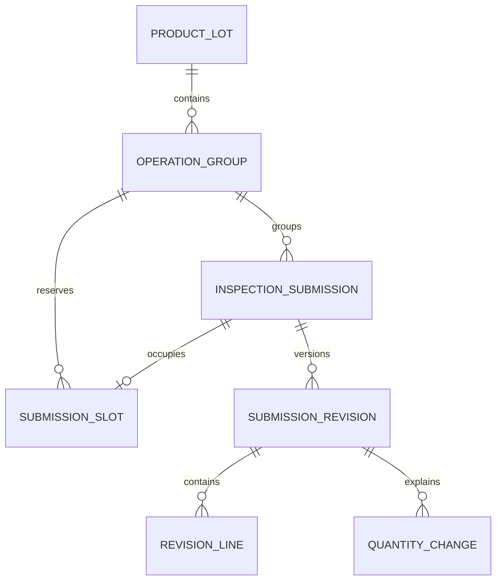

# 无纸化检验台账 — 系统设计

版本：v2.0-draft.2。日期：2026-11-04。状态：拟定设计，尚未实现。

上游：[需求基线](requirements.md)。接口：[API](api.md)。实施、待确认及决策状态：[重建计划](rebuild-plan.md)。本设计接续归档 v0.3，撤销原生日期存储要求，补入空批次整批语义与后续提交校验。

## 1. 现有工程与改造边界

沿用 Go 单体、Gin、sqlx、手写双库 SQL 迁移。当前 [go.mod](../backend/go.mod) 声明 Go 1.26.0，旧文档的 1.24 说明已过时。SQLite 是受支持的部署选择，不因日期字段切换数据库；PostgreSQL 继续保留。

| 已核对现状 | 新设计 |
|---|---|
| `forms.form_no` 全局唯一，`Service.saveTx` 同号合并 | 共享身份与单据 ID 分离，明确新建/修改，v2 不兼容旧 upsert 语义 |
| `ACTIVE/VOID`，计数是默认零的 int | 草稿/发布/取消＋可空计数；原正式结果与修订草稿并存 |
| `form_history` 保存前快照，`save_count` 可选校验 | 不可改内容版本＋强制并发版本，发布后按版本排重 |
| 纸面日期任意字符串，统计 COALESCE 后截取/比较 | 规范日期文本与规范 UTC 时间文本，原文独立；按明确业务日或系统时间筛选 |
| 幂等中间件处理响应后再写缓存，错误时放行 | v2 写操作幂等结果与业务事务一致，存储失败不继续写业务 |
| 无产品批、工序组、批次、设备、数量变化实体 | 新增业务表；复用账户、字典、解析器与缺陷目录 |

代码依据：[模型](../backend/internal/inspection/models.go)、[保存](../backend/internal/inspection/service.go)、[统计](../backend/internal/stats/service.go)、[幂等](../backend/internal/idempotency/http/http.go)、[时间工具](../backend/internal/store/time.go)、[现有唯一索引](../backend/migrations/sqlite/0003_form_submission.sqlite.up.sql)。源码中的旧文档节号也需在实施阶段同步。

## 2. 关系与身份

未归组草稿的 `operation_group_id` 可空；绑定前不占用 slot、不进工序统计，发布前必须绑定。除此之外，一单一工序组一检验范围。

### 2.1 拟定表结构

表名均为新增设计；不修改或重写已发布迁移 0001–0004。新迁移号实施时确定。

| 表 | 核心字段/约束 |
|---|---|
| `product_lots` | `id, shared_form_no, sample_identity, sample_identity_key, sample_raw`，五个样品结构化项，`version` 与创建/更新时间；唯一 `(shared_form_no, sample_identity_key)` |
| `operation_groups` | `id, product_lot_id, operation_id, inspection_kind, template_version, reporting_state, batch_mode, version`；唯一 `(product_lot_id, operation_id, inspection_kind)`；工序引用稳定字典 ID |
| `inspection_submissions` | `id, operation_group_id NULL, batch_no NULL, state, version, current_revision_id NULL, draft_revision_id NULL`，创建/取消人时、取消原因；稳定单据身份 |
| `submission_slots` | `operation_group_id, batch_key NOT NULL, submission_id`；主键 `(operation_group_id,batch_key)`，`submission_id` 唯一外键；仅存未取消且已归组单 |
| `submission_revisions` | `id, submission_id, revision_no, base_revision_id, template_version`，纸质栏目、设备、样品原文快照/结构化项、业务日期、正式计数/声明计数、备注、保存人与时间、原因、发布人时；唯一 `(submission_id,revision_no)` |
| `revision_lines` | `revision_id, seq` 唯一；三个可空计数、35×3 可空缺陷整数、备注；与目录同源生成列 |
| `quantity_changes` | `id, revision_id, kind, direction, quantity NULL, reason, occurred_date NULL, occurred_at NULL`；量为非负整数，方向独立表示 |
| `v2_idempotency_requests` | `(actor_id,idempotency_key)` 唯一；方法、实际 URI、请求指纹、响应状态/内容、创建/过期时间；与业务同事务 |
| `audit_logs` | 复用/扩展原日志；记录对象、动作、旧新版本/归属、原因、系统用户与时间；不记录密码或令牌明文 |

所有日期/时间物理列均 **TEXT**（双库一致）；版本、序号为整数；缺失用 NULL。纸面单位、人名、检验时间等属于版本内容，不能只留在可覆盖的单据表头。

`sample_identity` 是完整业务型号，`sample_model` 只是辅助解析片段。身份键暂采用去首尾空白、其余逐字区分；不能把解析器的全角/大小写归一规则套到产品批主键。共享号同样暂仅去首尾空白。工序编码映射到稳定字典 ID；未知工序可通过维护字典登记并用通用模板，不限定工序集合。

产品批创建时必须有共享号和完整身份型号；没掌握时先保存未归组草稿。产品批身份修正、单据移组不开放普通 PATCH；初期用明确取消/新建处理单据归属错误，产品批批量改键/合并另行设计。不同键不得自动合并。

### 2.2 slot 与批次模式（设计建议）

| 概念 | 值 |
|---|---|
| `batch_no` | 新建归一：不传/null/空串/首尾空白后空 → NULL；非空文本去首尾空白 |
| `scope` | 响应派生：NULL 批号为 `WHOLE`，非空为 `SPLIT`，不接受客户端另传 |
| `batch_key` | 内部唯一键：整批为 `''`；分批为非空规范批号；不使用可与真实批号碰撞的“未分批”字面值 |
| `batch_mode` | 工序组维护 `EMPTY/WHOLE/SPLIT`；由占用推导/事务维护，客户端不能直接指定 |
| 占用 | 归组初始草稿立即占用；发布/修订沿用同一 slot；取消释放；历史单不再占用 |

不依赖多个 NULL 是否唯一来保证整批单唯一。slot 主键只解决同号重复，整批/分批互斥必须额外锁工序组检查，不能误以为两条不同 batch_key 的唯一索引足够。

草稿绑定工序组时也需检查模式与批号；冲突可继续保留未归组草稿，不能因此自动改成“另一个匿名分批”。未归组草稿可编辑批号；一旦归组，批号/组 ID 固定。真实设备或人员发生变化应分成独立检验单位；修订只用于纠正记录，不用于把两次真实执行折叠为一批。

取消最后一张 slot 后 `batch_mode=EMPTY`，但 `CLOSED` 不自动改成 `OPEN`。批号在取消后可由明确的新建重新使用，新旧单 ID 和历史不同；UI 应提示有取消历史。将来如需整批转分批的原子替代入口，需另行确认，本版不提供静默转换。

slot 新增/释放、模式或开放状态改变都推进工序组 `version`；仅更正已有单的内容推进该单 `version`。服务层同时验证 slot 的组/批号与单据一致、正式/草稿指针确属本单；能用组合外键表达的归属约束同步落到数据库。

### 2.3 正常检验与抽检隔离

`inspection_kind` 为 NORMAL/SAMPLING，放入工序组身份；同产品批同工序可有两组，各自管理 slot、batch_mode、reporting_state 和 version。单据读取时回显所属组的类型，版本/审计保留该类型快照；不建立正常单与抽检单之间的外键、来源或数量关联。共享产品批与工序仅用于分类导航。

未归组草稿自身保存类型，默认 NORMAL；绑定组时必须同类型。单据类型创建后固定，不允许普通 PATCH 将正常结果切为抽检或反向切换；录错通过取消后明确新建处理。已归组单据的类型不得与组类型不同，服务层及数据库归属约束保持一致。

抽检沿用相同表单模板、计数、缺陷、机台、人员、日期、版本和发布动作。前端仅增加“抽检”标记并校验不提交 LOSS 条目；后端不基于 SAMPLING 增加损耗字段隐藏/专用拒绝逻辑，保留通用结构与数据校验。若绕过前端直接写入，后端不承诺抽检损耗必为空，也不静默丢弃请求内容。

报告、统计和进度默认 NORMAL，查询 SAMPLING 时独立展示。请求查看全部类型时按类型分区，不输出跨类型的混合数量/良率/损耗总计；正常组关闭、修改、取消不影响抽检组，反之亦然。抽检损耗不用于业务损耗汇总，即使直接 API 写入也保留原始记录供查阅，不混入正常损耗。

## 3. 生命周期与版本

| 动作 | 前置与效果 |
|---|---|
| 新建 | 仅创建草稿，`version=1`，追加内容版本；已归组时获取 slot；没有按号更新分支 |
| 保存初始草稿 | 以现草稿为基准合并补丁，追加新内容版本，推进 draft 指针及单据 version |
| 创建/保存修订草稿 | 首次以当前正式版本为基准，后续以修订草稿为基准；旧正式指针不变；state 仍是 PUBLISHED |
| 发布 | 明确 `draft_revision_id`、`expected_version`；校验归组和 slot，设置该版一次性发布元信息，切换正式指针并清草稿指针；state=PUBLISHED |
| 取消 | 原因必填，清当前统计资格并释放 slot；版本、发布记录和草稿内容保留供历史查询；state=CANCELLED，终态不可普通保存/发布 |
| 关闭工序 | 人工声明不再新增；有无正式结果、字段齐不齐不自动触发；若仍有初始草稿则 409，先发布或取消 |
| 重新开放 | 原因、并发校验和审计；允许后续新增；不牵动其他工序 |

关闭后已有正式单仍可保存/发布修订或取消；未归组草稿绑定到该组视为新增，必须先开放。已有修订草稿不阻止关组，报告需显示存在未发布修订。关闭空组允许，明确代表声明该工序填报结束且无有效结果。

版本内容包括全部关联行与数量变化，**保存后不原地修改**；发布元信息仅允许从未发布到已发布设置一次。废弃草稿保留为历史内容版本但不入正式统计。`revision_no` 是内容序号，`version` 是并发令牌，发布/取消也推进 version，两者不等同。

更正 A 的数量只重算 A、其设备/人员/日期及产品批报告中 A 的分区，不改变 B 的结果或要求 B 重填。历史报告通过实际纳入版本集合和取消/发布事件解释；按时间回放需保留事件顺序，秒级时间相同时用事件序号排定。

## 4. 事务、并发及幂等

每次 v2 变更都要求 `X-Idempotency-Key`；更新已有对象另要求 `expected_version`。幂等回放先于旧版本校验，否则成功重试会错误返回版本冲突。

单事务顺序：

1. 认证并读取请求，校验格式；按当前用户＋幂等键查询/竞争唯一记录，指纹包含方法、实际路径（含具体 ID）、规范查询串与原始请求体。
2. 同键同指纹的已完成记录回放首个成功结果；不同指纹 409；并发正在处理返回 409 `request_in_progress` 或在有界等待后回放。
3. PostgreSQL 锁目标工序组行，再锁单据并核验 version；SQLite 使用同一连接的即时写事务或等价串行写入策略，覆盖“读模式→建 slot→更新模式”全过程。数据库 busy/超时不降级放行。
4. 按需求 §3 判断整批重复、模式冲突及批号重复，校验组状态、slot 与正式指针；所有写入路径共用同一服务层逻辑。
5. 追加内容/发布/取消事件，写 slot、模式、版本、审计与成功响应；幂等结果与业务一起提交。
6. 提交后返回响应；断网重试回放同一结果。业务失败整体回滚，可使用同键同内容重试；修正内容则使用新键。

幂等存储故障必须回滚，不能采用旧中间件的“缓存故障仍继续业务”。TTL 默认拟沿用 24h；过期后仍靠 slot、业务唯一键和版本防重。两次不同键但相同业务身份的新建，后到请求返回业务冲突。

批量新建在一个事务按组 ID 固定顺序加锁；每项均执行相同规则，同组整批/分批混合、重复批号或任一失败整批回滚，返回失败项 index，不部分成功。重试键属于整个 HTTP 请求，不复制为每项独立键。

## 5. 内容与数量

### 5.1 单一正式事实源

`counts={total_qty,qualified_qty,defect_qty}` 是当前版本的唯一正式指标，每项可空；纸面另有不一致的表头值放 `declared_counts`，明细合计为派生核对值。不再“本轮显式表头优先、下轮又按行重算”。如需从明细得到正式计数，调用方明确确认后写入 counts，并记录本次原因。

草稿 PATCH 的对象字段递归合并，字段不传保持、null 清未知；counts 对象不传保持，`counts:null` 三项清空，`counts:{}` 不改。`lines/quantity_changes` 不传保持，传数组整组替换；`[]` 清空，null 非法。替换数组内的省略计数/缺陷格为未知，不继承旧行，也不自动为零。

负计数、非整数、未知字段、非法规范日期永远拒绝。缺项、样品参考不匹配、已知存在的多类缺陷重复只提示。正常检验与独立抽检各自的单批算式与界限仍需明确，本版先警告，不沿用旧 `enforce` 去绕过身份或日期校验。合格率只读，分母未知/零、分子未知或分子大于分母则 null 并说明原因。

### 5.2 数量变化

本版建议 `kind=LOSS/ADJUSTMENT/OTHER`，`direction=DECREASE/INCREASE/UNKNOWN`，枚举待 Q-07 确认；LOSS 必为 DECREASE。数量用非负可空整数，原因非空；原因明确而数量未知允许。可选业务日期或时点二选一，系统记录人时从会话生成。

变化随版本保存，当前正式版中每项只计一次，绝不自动修改 counts 或后序单据。不同类型/方向分组展示“已知量＋未知条数”；相同原因是否重述同一事件无法自动推断，不声称跨单损耗已去重。

## 6. 日期/时间文本契约（替代原生日期方案）

| 类别 | 字段举例 | 存储与输出 |
|---|---|---|
| 业务日期 | `paper_submitted_date, paper_inspected_date, occurred_date` | TEXT `YYYY-MM-DD`，合法公历日期，固定 10 位 |
| 准确时间点 | `paper_submitted_at, paper_inspected_at, occurred_at` | TEXT UTC `YYYY-MM-DDTHH:mm:ssZ`，固定秒精度、20 位 |
| 系统时间点 | 创建/更新/发布/取消、会话到期/锁定、审计、幂等过期 | 同一 UTC 秒精度文本；业务接口不可伪造系统字段 |
| 原始纸面文本 | `paper_submitted_raw, paper_inspected_raw`，迁移原值 | 原文保留，不用于规范日期排序与筛选 |
| 业务归日 | `paper_inspected_day` 等只读派生字段 | TEXT `YYYY-MM-DD`；日期值直接取日期，时点按业务时区换算 |

同一个业务事件的 `_date` 与 `_at` 至多一个非空，都空表示未知；仅知日期不补造午夜。PATCH 切换精度时需显式清空旧字段，否则合并后两者非空返回 422。合法年份范围暂定 0001–9999。UTC 输入或带显式偏移的 RFC3339 秒精度输入均可，输出先转 UTC；不接受无时区时刻、斜杠/点分日期、毫秒或模糊简写，避免静默截断。原文可放 `_raw`，不自动进入标准字段。

例如 `2026-11-03T00:30:00+08:00` 入库为 `2026-11-02T16:30:00Z`；业务时区 Asia/Shanghai 下归日仍为 `2026-11-03`。拟定单一业务时区 `Asia/Shanghai`，部署时确认；不用宿主机本地时区。业务时区变更需重新计算派生日，不能无记录地改历史报表。

应用可解析成 Go 时间值验证、换算，最终仍以规范字符串写库，**不要求 DATE/timestamptz 列，也不以 JSON 字符串掩盖物理列变更**。同一类规范文本可按字典序排序/区间过滤；日期与时间点、原文不得混在一个 COALESCE 中比较。只对已校验的派生日截取月份，不直接截取原文。

查询明确 `date_basis=inspection_day/created_at`。业务日范围 `from/to` 是包含首尾的日期；系统时间范围 `from/to` 是 `[from,to)` UTC 时间点。未知业务日单列数量，不回落到创建日期。默认业务日统计，系统工作量按系统时间；详情同时展示两者。

旧系统秒精度时间可沿用；旧纸面非标准日期按[迁移说明](migration.md)清洗，原始证据保留，无法确定的标准值为 NULL。会话过期比较继续规范 UTC 文本/解析值，不把非法旧值当有效远期时间。

## 7. 查询、统计及索引

正式统计先在一致读视图中确定每张有效单的 `current_revision_id` 集合，再聚合各自计数、缺陷和数量变化。多对多/一对多明细先按 revision 聚合，不能直接联接明细与变化后乘倍。同一请求的分组、总计和版本集合来自同一读事务快照。

计数分别返回 `known_sum/unknown_count/complete`，存在未知时完整 `value=null`；仅无记录时返回 0 和样本数 0。完整可比范围且总分母大于零才有合格率。草稿只作暂报，初始草稿数与修订草稿数分开；已发布但有修订草稿的单只正式计一次。

维度包括产品批、工序、批号/整批范围、设备、纸面人员、样品核心五项、单位、系统录入人、业务日/月。跨工序累加明确为工作量；设备/人员多值不挤成一个末值。工序差额是信息，不能命名准确损耗或库存。

报告响应附 `as_of` 和实际 `included_revision_ids`。P3 先保证当前查询一致及返回版本集合；可分享的持久快照/历史时间回放实现深度待确认，不以尚未建成的快照能力承诺历史报表。

索引：产品批身份唯一键；工序组唯一键；slot 主键；单据 `(operation_group_id,state)`；版本 `(submission_id,revision_no)` 与业务日/设备/人员；明细 `(revision_id,seq)`；数量变化 `(revision_id,kind,direction)`；幂等唯一键和 expires_at。字典序索引只用于符合 §6 规范的文本。

## 8. 实施与验证边界

新增 `/api/v2`，沿用 `/api` 认证、用户、字典及样品解析；v2 新业务不得经过旧按同号覆盖逻辑或旧幂等中间件。切换前旧域仍按原逻辑运行，切换后业务写入口只留一个，旧域只读。账户及密码哈希原样保留，不以清库作为重建步骤。

核心验证以需求 AC-01–AC-15 为索引，特别覆盖 SQLite/PostgreSQL 整批/分批并发竞争、批量内部冲突、原正式版与修订草稿、未知数量、午夜归日和幂等提交后断线。当前没有 v2 迁移、服务或测试；本轮只检查文档一致性，不将旧测试通过视为 v2 验收。
