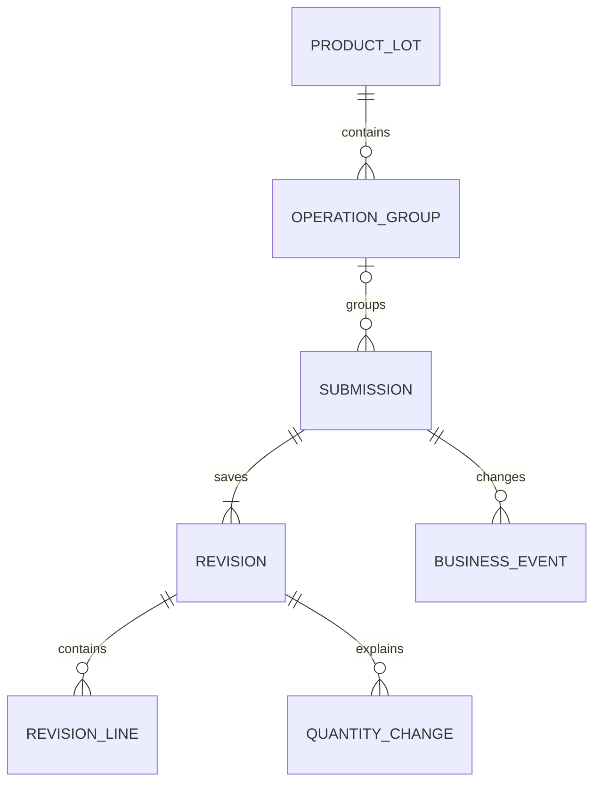
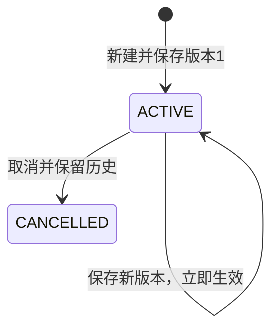

# v2 系统设计

修订日期：2026-11-05。本文是目标系统规格，不以代码、迁移编号或既有部署作为设计依据。业务口径见[需求](requirements.md)，跨模块规则见[公共设计](common-design.md)，字段定义见[字段目录](fields.md)，线上协议见[API](api.md)。

## 1. 领域结构

生产批是共同身份；填报组按工序与类型区分；检验单是一检验批次；内容版本是保存历史。没有跨工序检验批次间的连接，也没有在单据内再次划分实物执行段。未归组单据暂时没有填报组，保存和历史有效，归组前不进入分组统计。

同共享号＋完整型号共用一个 product_lot_id，包括正常与抽检记录。独立性在 operation_group 的 inspection_kind、单据身份占用、统计及填报状态体现，不为两种检验复制生产批身份。

## 2. 数据模型与约束

### 2.1 生产批 product_lots

| 列 | 类型/约束 | 作用 |
|---|---|---|
| id | TEXT PK | 稳定 ID |
| shared_form_no | TEXT NOT NULL | 去首尾空白后的共享号 |
| sample_identity | TEXT NOT NULL | 完整型号文字，保留内部空格和大小写 |
| sample_identity_key | TEXT NOT NULL | 仅 trim 后的确定性身份键 |
| sample_raw | TEXT NULL | 创建时参考样品原文，不自动替代各单原文 |
| sample_project/model/spec/size/side | TEXT NULL | 创建时参考结构化资料，不是单据统计来源 |
| version | INTEGER NOT NULL | 对象版本，初始 1 |
| created_by/created_at | TEXT NOT NULL | 可信创建者及系统时点 |

唯一键 (shared_form_no, sample_identity_key)。接口不进行模糊大小写匹配、去标点、内部空格折叠或由 sample_model 拼接身份。重复新建报冲突并给现有 ID，不自动覆盖。日常无生产批改键/合并 API。

### 2.2 工序填报组 operation_groups

| 列 | 类型/约束 | 作用 |
|---|---|---|
| id | TEXT PK | 稳定 ID |
| product_lot_id | FK NOT NULL | 归属生产批 |
| operation_id | FK NOT NULL | inspection_operation 字典 ID |
| operation_code/operation_label | TEXT NOT NULL | 创建时工序编码/显示快照 |
| inspection_kind | NORMAL / SAMPLING | 类型隔离 |
| template_version | TEXT NOT NULL | 组采用的字段/布局版本 |
| reporting_state | OPEN / CLOSED | 是否允许新增/归组 |
| batch_mode | EMPTY / WHOLE / SPLIT | 防重占用派生模式 |
| version | INTEGER NOT NULL | 并发令牌，初始 1 |
| created_by/created_at | TEXT NOT NULL | 创建证据 |

唯一键 (product_lot_id, operation_id, inspection_kind)。不存在路线、前序组、计划批次数、可用量字段。字典停用工序后禁止新建该工序组，已有组的补填/取消/历史仍有效。

组状态变化、单据占用增加/释放推进组 version。纯内容保存不推进组 version。CLOSED 禁止新增及未归组记录绑定，但已有有效单可继续更正、取消。关闭空组合法；关闭不检查资料完整度，也不等待其他工序或类型。重新开放仅影响本组。

### 2.3 检验单 inspection_submissions

| 列 | 类型/约束 | 作用 |
|---|---|---|
| id | TEXT PK | 稳定单据 ID |
| operation_group_id | FK NULL | null 为未归组记录 |
| inspection_kind | NORMAL / SAMPLING NOT NULL | 创建时由账户决定，之后不可改 |
| batch_no | TEXT NULL | 空代表整批；非空 trim 后保留大小写 |
| scope | WHOLE / SPLIT | 由 batch_no 派生，不能客户端填写 |
| state | ACTIVE / CANCELLED | 有效或取消 |
| version | INTEGER NOT NULL | 所有修改动作推进 |
| current_revision_id | FK NOT NULL | 当前内容版本，必须属于本单 |
| created_by/created_at | TEXT NOT NULL | 首次系统录入 |
| last_saved_by/last_saved_at | TEXT NOT NULL | 最近内容保存 |
| cancelled_by/cancelled_at/cancel_reason | 可空 | 取消证据 |

无 draft_revision_id、published_at 或待发布状态。内容保存即当前有效内容；是否统计只取决于 ACTIVE 且已归组。创建/取消/绑定等状态用审计回放，不能通过今天的状态推过去。

未归组记录允许更改批号并在保存时绑定；已归组记录的生产批/工序/类型/批号固定。录错按明确取消和重建处理，保留两张单的证据；不做无审计移组或自动合并。

### 2.4 内容版本 submission_revisions

每次成功新建或 PATCH 形成一条完整版本，含 id、submission_id、revision_no、base_revision_id、template_version、content_schema_version、content_json、saved_by、saved_actor_name、saved_at、reason。revision_no 从 1 连续增加，唯一 (submission_id, revision_no)，base 指向本单上一内容版本。对象取消不生成虚构内容保存版本，但推进 submission.version。

content_json 保存纸面、样品、机台、表头计数、明细、变化和备注的完整规范化快照。常用筛选列（机台/人员/样品五项/检验业务日/计数/完整度）与快照在同事务投影，禁止两套独立修改。正式计数投影只来自 content.counts；不存储独立纸面数量声明或声明原始值列。明细合计和差异是只读核对结果，不回填或覆盖 counts，不由字段本次是否出现改变统计来源。

版本一经保存不可原地更新，不提供历史恢复覆盖；若要采用旧内容，应读取旧版后明确保存成新版本。原因可空，历史仍记录操作者与前后内容。目录标签和操作者显示名保留当时快照，后续改名不污染历史。

### 2.5 明细与数量变化

revision_lines 归属 revision_id，唯一 (revision_id, seq)，含三项可空行计数、105 个可空缺陷格及 remark。存储可采用固定整数列，由同一字段目录生成映射；未知格为 NULL，不能 DEFAULT 0。历史行不能通过覆盖当前行表而丢失。

quantity_changes 归属内容版本，包含 kind、direction、quantity、reason、occurred_date/at 和只读条目 ID。同次数组替换生成新版本条目，旧版保留。统计先选 current_revision_id 后汇总，不累计所有历史条目。

SAMPLING 的 LOSS 由服务端拒绝，无“只在界面禁止”的例外。通用校验仍要求 LOSS 方向 DECREASE、数量非负/可未知、原因非空。其他条目不自动改变 counts。

### 2.6 计量单位与用户部门

纸面单位只允许“片”。固定计量单位目录可提供一个稳定 ID；paper_unit_id 指向该项，paper_unit_text 只能是 null 或精确文字“片”。提交任一有效形式即可表达单位，二者均无为缺项，允许保存并提示。传其他计量名称、部门、无效 ID 或 ID/文字矛盾均 422，不因前端固定传值而省略校验。

用户的部门资料是独立 department 文本，与计量单位目录无外键关系。禁止将用户所属组织自动写入纸面单位；所有数量按片计，不提供多单位换算或混合单位求和。

## 3. 防重与范围占用

同生产批＋工序＋类型内，整批与分批互斥，具名批号唯一；取消后释放占用，批号可重新使用。

submission_slots 以 (operation_group_id, batch_key) 为主键，submission_id 唯一；batch_key 对整批使用保留的空字符串，对分批使用 trim 后批号。只为 ACTIVE 且已归组单据持有占用；未归组不占，取消释放。

| 现有占用 | 新建整批 | 新建同名分批 | 新建其他分批 |
|---|---|---|---|
| EMPTY | 允许 | 允许 | 允许 |
| WHOLE | 整批已存在 | 整批/分批冲突 | 整批/分批冲突 |
| SPLIT | 整批/分批冲突 | 批号已存在 | 允许 |

组关闭优先拒绝新增，再判断模式和重复。最后一个占用释放后模式 EMPTY；取消历史仍可读，不参与占用或当前统计。模式不能由数量是否为零、是否完整推定。

正常组和抽检组各自持有占用，同生产批同工序可以分别使用相同批号或各有一张整批单。跨工序同名批号无关联。

## 4. 状态与写入协议

### 4.1 保存事务

1. 验证请求结构、认证、幂等键及控制字段。
2. 获取数据库业务写闸门，在事务内读取当前用户状态与类型，校验目标类型。
3. 查询该用户/键的成功结果；指纹一致则回放，类型变化或权限失效不能回放旧结果。
4. 读取目标对象，检查 expected_version、取消状态、归组权限、组开放状态及占用。
5. 以当前完整内容为基础递归合并补丁；数组完整替换；校验单位/数值/日期/抽检 LOSS，计算提示和派生字段。
6. 写入完整内容版本及投影，原子推进当前指针和对象版本；需要时更新占用与组模式/版本。
7. 追加业务事件与审计，持久化成功响应和幂等指纹，提交事务后返回。

任何失败全部回滚，不能写成“保存已成功但留痕/幂等失败”。对取消单保存拒绝；空内容补丁且没有绑定/批号动作拒绝。显式非空补丁即使值与现状相同仍算一次保存，但原键重试只生成一次。

### 4.2 取消与组状态

取消校验单据 version、类型与必填原因，设置 CANCELLED，释放占用，推进单据和必要的组版本，写事件及幂等结果。取消不可普通恢复，新建用新 ID；原键回放成功，新键重复取消报冲突。

close/reopen 校验组 version、类型与必填原因。关闭后补填/更正/取消已有单仍合法，只有新增/绑定受限。不联动其他工序/类型，也不声明真实生产结束。

### 4.3 数据库并发

用数据库内单行业务写闸门串行化领域写事务，保证双库对整批/分批竞争、历史事件次序和批量冲突的一致语义；SQLite 事务开始即取得写锁，PostgreSQL 锁同一行。不能以进程内互斥代替跨实例数据库锁。锁等待与请求有界，耗尽返回 503，不跳过校验。

唯一约束/外键是最后防线：占用唯一、对象版本条件更新、内容版本归属、组与类型一致、当前指针属于本单。不得仅靠先查后插而不加锁/约束。全局写串行适合目标规模，不承诺多实例线性写扩展。

## 5. 完整度和校验

完整度固定按以下顺序输出 missing_fields：

| 键 | 满足条件 |
|---|---|
| operation_id | 已归组，能明确关联有效工序身份（历史停用不算缺失） |
| paper_unit | paper_unit_id 或 paper_unit_text 提供合法“片”单位 |
| paper_inspector | 非空白文字 |
| sample_raw | 非空白原文；检查不改写原文 |
| lines | 至少一条合法明细行 |

缺失则 is_complete=false，仅提示，不限制保存、统计或关闭组。数量未知不加入这五项，但在计数完整性中分别表达。未归组单因 operation_id 缺失而不完整。

负数、非整数、非法日期、重复行 seq、非法枚举、无效单位和未知字段拒绝。三项齐全但不平衡、单项超过合理边界、缺陷重复或与不良数不符、纸面未来日期仅提示。单位不合法不是缺项，不能作为可忽略 warning 保存。具体 issues code/path 见 API。

## 6. 日期与时间

业务日期为 YYYY-MM-DD，准确时点为带偏移 RFC3339 秒精度输入，存储/输出 UTC YYYY-MM-DDTHH:mm:ssZ。两库物理列可用 TEXT，但服务端解析真实公历日期后才能存，固定格式才允许范围排序。

同事件 date/at 至多一个非空，均空表示未知。切换精度时补丁显式清旧字段。拒绝自由日期文字、无时区时点、小数秒与非法日期，不静默截断、不另存日期原文。样品原文和人员文字仍保留。

inspection_day 从检验日期直接取得，或从检验时点按 Asia/Shanghai 派生。不用创建时间/送检时间兜底。业务日期范围含首尾；系统时点范围 [from,to)。系统 created_at/saved_at 为可信系统时间，纸面过去/未来时间不能影响事件发生顺序。

## 7. 统计选择与未知量

每次查询先在一致读事务中固定集合 S={(submission_id, current_revision_id)}，限定 ACTIVE、已归组、筛选类型与条件。随后分别从 S 聚合计数、明细缺陷及数量变化，再组装结果，禁止三种明细直接相连导致乘倍。

三项数量及良率的输入固定为选定版本的表头 counts。明细计数仅用于 line_totals/count_differences 核对，表头未知不能以明细替补；仅改 lines 的保存不改变表头计数及其统计结果。缺陷分布继续读取选定版本明细缺陷格，数量变化独立统计，不与三项表头数量相互扣补。

数值单元统一为 value、known_sum、unknown_count、complete：未知存在则 value=null，known_sum 仍显示已知部分；完整时 value=known_sum。计数 unknown_count 按单据计，不按版本或明细行数计。无记录视为空和 0，不能据此计算良率。

缺陷先在一张单当前版内按格合并明细。无明细或任一行该格未知，则本单该格不完整；已知格保留已知部分。跨单 unknown_count 为缺该格的单数。全表缺陷和仅表示登记的缺陷计次，不称唯一不良件数。

良率采用完整合格量/检验量合计，分母正数且分子不超过分母才输出百分数两位小数。任一单据已知分子超过分母时整个对应分组标记不可比，即便合计恰好掩盖矛盾也不输出可用良率。其他数量算式差异保留 warning，不悄悄重写数值。

正常/抽检分区；ALL 强制含 inspection_kind 分组，返回各类型 totals，不给混合总计。跨工序相加只称检验工作量。共享产品批不定义全流程总产量和良率。

## 8. 历史时点报告

### 8.1 事件与重放

业务事件保存全局递增 event_id、事务标识、系统秒精度时间、实体 ID、操作类型、before/after 元数据和当前内容版本指针。生产批、组、新单、保存、绑定、取消、占用模式和组关闭/开放均有事件。单次事务的全部事件作为一个原子边界；历史视图不截取事务中间状态。

写闸门保证事务事件提交顺序；事件时间使用服务端统一 UTC，按时间再按事件序号解释，同秒支持固定上界。数据库时钟回退不能破坏顺序，应以持久化最近逻辑事件时点约束。对外 through_event_id 指向最后一个已提交完整事务的末事件，任意中间事件上界拒绝。

查询 as_of 时在一致快照内选择截止时点已提交事件，按序还原实体元数据和当前版本指针；内容从不可变版本读。取消之前的报告保留单据，当时尚未归组的单不能混入当时组统计。后来保存、归组或修改目录不泄露到过去。

### 8.2 回放范围

系统保存 history_started_at，代表完整可证明事件历史的起点。新库从首次业务事件开始；已有资料若缺历史，只能显式建立基线并注明起点，不能把当前数据伪装成过去。起点之前返回 history_unavailable；时点尚不存在的生产批返回 404。

报告携带 as_of、through_event_id、included_revision_ids 及各组填报状态/版本/单据/小计。未建组不伪造“未生产”。as_of 与 through_event_id 组合可复验同一视图，不提供亚秒时间推测。历史留痕是数据修订历史，不是跨工序实物追溯。

## 9. 工序范围报告与工作量

范围报告取当前版本，按所选业务日或创建时点筛选，可跨生产批或限定单批。items 按页返回，summary、计数、版本集合和未知日期数量按完整筛选范围计算；取消资料可列而不计统计。翻页顺序以时间＋稳定 ID 固定。

unknown_day_count 定义为满足其他非时间筛选的对象中业务检验日未知的单数，忽略日期区间，不计作区间内记录。state/类型筛选仍适用。避免未知日期被既丢弃又没有提示。

纸面检验人工作量由当前有效单据数量统计；系统账号创建/最近保存归属由单据字段统计；真正“保存动作次数”从审计计算，不把每个历史版本都当新增检验量。工作量接口明确三种口径。

## 10. 实现验证要求

以需求验收场景为准，另覆盖：SQLite/PostgreSQL 并发占用、双库 NULL 语义、事务失败无半写、幂等权限复查、同秒完整事务边界、字典/账户改名后的历史快照、单位严格校验、抽检 LOSS 拒绝、批量全回滚和分页统计不截断。接口例子和字段目录必须相互一致。本文不包含施工计划、发布进度或清库指令。
